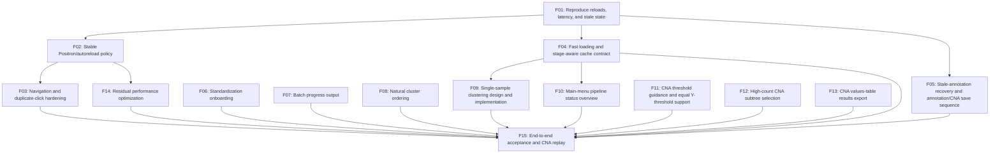

# Che2021 Colorectal 2 — Follow-up Development Plan

**Document purpose.** This is the working implementation plan for issues found during the 2026-10-21 manual end-to-end test on `Che2021_Colorectal_2`. It follows the structure of `scAnnotationPipeline_Development_Plan.md`, but is a separate follow-up plan because the original milestones are complete. It records priorities, dependencies, acceptance criteria, and implementation order. It does not claim that the planned changes have been implemented.

**Initial plan date:** 2026-10-21  
**Last progress update:** 2026-10-21  
**Current phase:** Milestones 0–1 complete; Milestone 2 ready  
**Basis:** Manual test notes, follow-up console-launch testing, current source inspection, file-size inventory, `pipeline.log`, and `pipeline_state.yaml` from `Che2021_Colorectal_2`.

---

## 1. Scope and planning principles

The immediate objective is to restore a stable, responsive workflow through clustering, DE, annotation, and CNA, then improve guidance and presentation. Work should preserve scientific outputs unless a task explicitly changes a presentation-only ordering.

| Priority | Meaning | Included issues |
| --- | --- | --- |
| **P0 — Critical** | Blocks or corrupts the normal workflow | unexpected app/session resets; false stale clustering/annotation state after saving |
| **P1 — Important** | Makes core use confusing or inefficient | annotation/CNA save semantics; new-dataset onboarding; batch progress and completion output; general responsiveness |
| **P2 — Improvement** | Nonblocking consistency, optional workflow convenience, status visibility, CNA selection usability, or environment polish | natural cluster ordering; single-sample clustering; main-menu pipeline overview; high-count CNA cluster selection; development-mode startup warning |

Complexity is relative: **S** = localized; **M** = several functions/modules; **L** = cross-cutting state, cache, or integration work.

Implementation rules:

- Reproduce and instrument before changing behavior. In particular, distinguish an in-app navigation bug from a full Shiny session reload.
- Fix runtime/session stability and cache correctness before continuing the interrupted CNA manual test.
- Do not solve the Positron warning only by suppressing it. Decide whether autoreload should be disabled or safely configured for this data-writing application.
- A saved annotation must never make valid clustering results stale merely because annotation columns changed.
- Keep annotation, CNA configuration, and explicit CNA omission as distinct user decisions and workflow states.
- Add regression tests with each change and perform the final manual replay on a disposable copy or synthetic workspace before relying on the test dataset.

## 2. Current evidence and working hypotheses

These findings guide task order. Items labelled **hypothesis** still require the Milestone 0 reproduction.

| Observation | Current evidence | Planning conclusion |
| --- | --- | --- |
| All buttons and tab changes became slow after moving from RStudio to Positron | Positron starts Shiny development mode with legacy autoreload. The app writes caches, logs, state, YAML, plots, and standardized files below its own application directory. Starting manually from the console with autoreload disabled improved selection responsiveness, and the subsequent clustering/DE workflow no longer reset to Dataset Selection. | **Confirmed for the reported test:** use console launch with autoreload disabled as the normal runtime policy. Complete F02 by documenting and regression-checking this launch path; retain navigation guards as defense in depth. |
| Dataset loading remains slow when the app is started manually | Every dataset load calls `reconcile_pipeline_state_cache()`. For this 15-sample dataset it can validate 15 filtered-expression caches and 60 resolution-specific clustering caches. `cache_check_valid()` fully deserializes each cache, while dependency construction repeatedly reads `Cells.csv` and checksums expression inputs. The 15 standardized expression matrices total about 2.14 GB; rebuilding filtered plus four resolution fingerprints can read roughly 10.7 GB of expression input, in addition to cache reads. | **Confirmed separate architectural bottleneck:** replace eager deep validation during initial load with a fast manifest/input-metadata pass and deferred full validation when an artifact is used. This is part of F04, not only residual optimization. |
| Clustering completion, DE completion, and annotation save appeared to return to Dataset Selection | The app only selects `dataset_tab` in the explicit change-dataset handler. The log shows fresh `dataset_load` events after each reported incident, consistent with a restarted/reloaded session followed by a reload, but the log cannot identify the trigger. | First prove whether the Shiny session restarts. Only add click guards if the problem remains with autoreload disabled. |
| Resolution remained stale after bulk clustering was rerun | Rerunning clustering correctly invalidates the prior resolution decision because cluster membership may have changed and the resolution must be reviewed again. Reselecting and saving the resolution cleared the stale state as designed. Some samples retained the reason “The clustering step is being rerun for this sample” after clustering had completed. | Preserve explicit resolution review after clustering reruns, but replace the lingering present-tense reason with a completed, actionable message such as “Clustering was rerun; review and save a resolution again.” Test state-reason updates at rerun start, success, and failure. |
| Previously annotated samples remain stale and cannot be reopened after successful DE rerun | The affected samples now have completed clustering, resolution, and DE records, but annotation remains stale with the obsolete cache-error reason. A stale annotation should require review, not prevent review. The annotation loader is driven by `input$sample_idx` and returns early when that index equals `annotation_loaded_index`; if the sample was selected while prerequisites were stale, a later DE completion does not necessarily retry loading it. | **Confirmed workflow blocker with a likely UI-reactivity cause:** refresh annotation data when readiness changes to ready or when Manual Annotation is entered, allow stale annotations to be reviewed/replaced, and rewrite the stale reason to describe the completed upstream rerun. Cover same-sample retry explicitly. |
| Annotation appeared stale after a successful save | A fresh synthetic replay with the current dependency contract does **not** reproduce an annotation-only save making clustering stale: clustering fingerprints include only `cell_name`, `sample`, and `complexity`, and the rewritten selected cache inherits its dependency record. The reproducible transition is instead: rerun clustering → downstream annotation becomes stale → save resolution → rerun DE → annotation remains stale with the old clustering-rerun reason. | Treat stale-annotation re-entry and reason refresh as the confirmed blocker (F05). F04 should still separate immutable clustering artifacts from mutable annotation data, but must not claim the current save path alone is the reproduced trigger. |
| CNA computation feedback and navigation were tested | The computation popup provides enough progress information, and returning automatically to the main CNA view makes the current CNA pipeline state visible. | Preserve both behaviors while changing nearby CNA controls. Add them to regression acceptance rather than redesigning them. |
| CNA Y-threshold sliders require a gap even though save validation permits equality | The dynamic slider observers set `m_y` minimum to `nm_y + 0.01` and `nm_y` maximum to `m_y - 0.01`. The save guard rejects only `m_y < nm_y`, so equal values are already valid in the persisted contract but cannot be selected in the GUI. | Remove the forced 0.01 Y gap while preserving `m_y >= nm_y`. Keep the X-threshold gap unchanged. Document how exact-boundary cells are classified. |
| CNA threshold controls do not explain their classification effect | The view names malignant and non-malignant X/Y thresholds but does not tell the user that cells above both malignant thresholds may become malignant only when their current type is eligible, cells safely below the non-malignant thresholds retain their type, and tested cells in the intervening/mixed region become Unassigned. | Add concise helper text beside every threshold control group, using text and structure rather than colour alone and matching the implemented strict comparison rules. |
| CNA malignant-cluster selection becomes ambiguous at high `k` | The current dendrogram-cut workflow represents clusters primarily with many colours and a separate selector/legend. As `k` grows, colours become difficult to distinguish, and selector/legend order does not communicate the same left-to-right order as the cluster bar. The user cannot be fully certain which subtree was selected. | Preserve selection of one or more cut-tree subtrees, but prototype redundant identity cues and direct spatial selection. Colour may remain supportive but must not be the only mapping. |
| The gene-by-cell CNA values table is not published as a reusable result | `cna_matrix_<sample>.qs2` stores the internal wide matrix, while `load_expdt_from_cna_matrix()` converts it to the plotting table with columns `gene`, `chr`, `start_pos`, `cell_name`, and `cna`. That long table is not saved. Current compressed matrix caches are approximately 22 MB and 75 MB, and the long CSV may be substantially larger. | Export the validated long-format CNA values table in sample results when CNA assignment is finalized, with compressed CSV as the safe default and an explicit plain-CSV option/re-export action. |
| Save Annotations warns that CNA configuration is incomplete | The current UI orders Save Annotations before Save CNA Config, while the server requires a CNA decision during annotation save. | Redesign the save sequence so the UI and state machine agree. |
| Cluster legends show `0, 1, 10, 11, ..., 2` | `plot_clusters()` supplies cluster values directly to a discrete colour scale without numeric-aware factor levels. | Apply one shared natural-order helper to plotting and annotation controls. |
| Bulk console output lacks sample position and strong boundaries | Both clustering and DE already iterate with `i` and know the total sample count, but messages only identify the sample. DE has no batch-level console completion line. | Add a shared batch message/progress contract without changing analysis. |
| Bulk clustering and DE provide only a persistent notification plus console output while running | CNA uses Shiny progress overlays with current stage and, for batch CNA, sample position. The bulk clustering and DE handlers currently tell the user to check the R console but do not expose comparable in-app progress. | Reuse the CNA progress pattern for bulk clustering and DE, driven by backend callbacks so the popup reports real sample/stage progress rather than estimated animation. |
| A newly created dataset cannot be loaded before standardization | Loading intentionally rejects a missing or empty `processed_data` directory; creation currently closes with only a success notification. | Keep that safety rule, but make standardization guidance available from Dataset Selection immediately after creation. |

## 3. Suggested implementation order

| Order | Milestone | Task IDs | Main outcome | Gate before proceeding |
| --- | --- | --- | --- | --- |
| 0 | **Reproduction and timing baseline** | F01 | Separate session reloads, UI latency, and cache defects with reliable tests | Reload trigger and annotation-stale sequence reproduced or ruled out |
| 1 | **Stable development runtime** | F02–F03 | Positron launch no longer reloads on pipeline writes; navigation is single-shot | Long computations and saves remain in the same session |
| 2 | **Cache loading, correctness, and save semantics** | F04–F05 | Stale annotation is made re-enterable first; dataset loading avoids eager deep cache reads; annotation persists without invalidating clustering; CNA decisions follow a coherent sequence | Stale samples can be annotated; fast load and saved-annotation reload tests pass; CNA can be tested |
| 3 | **Onboarding and progress** | F06–F07 | New users can find standardization instructions; batch work has clear progress | Creation-to-standardization path and bulk output tests pass |
| 4 | **Presentation, optional workflow controls, exports, and residual performance** | F08–F14 | Numeric cluster order, optional single-sample clustering, a main-menu status overview, flexible CNA Y thresholds, unambiguous CNA subtree selection, reusable CNA values-table exports, and responsive ordinary interactions | New controls, exports, and measured interaction targets pass with autoreload disabled |
| 5 | **Integration and resumed CNA test** | F15 | End-to-end workflow, including CNA, is verified | All acceptance scenarios pass |

Performance work is split deliberately: F04 addresses the now-confirmed dataset-load/cache-validation bottleneck on the critical path, while F14 remains limited to residual interactive latency after autoreload and eager cache validation are fixed.

## 4. Dependency map



**Critical path:** F01 → F02 → F03, F01 → F04, and F01 → F05, converging at F15. Implement the stale-annotation re-entry slice of F05 immediately; it does not need to wait for the larger F04 performance/cache redesign. Coordinate final invalidation semantics between F04 and F05. F06–F13 can follow the critical defects; F09–F13 must not delay the fixes or CNA replay.

## 5. Milestone 0 — Reproduction and baseline

| ID | Priority | Complexity | Task | Dependencies |
| --- | --- | --- | --- | --- |
| **F01** | P0 | M | Build focused reproductions for Positron/autoreload session resets, navigation latency, duplicate actions, and annotation-save cache reconciliation | None |

F01 should record:

- a per-session identifier and start event so logs distinguish tab navigation from process/session restart;
- timings for plain navbar changes and lightweight buttons, with legacy autoreload on and with `options(shiny.autoreload = FALSE)`;
- file-write experiments for log, state, YAML, cache, and plot files under `datasets/`;
- whether a second click reaches a newly exposed control after a modal or tab transition;
- the existing sequence: load dataset → save annotations → reload dataset → reconcile cache/state;
- a clean copy of the affected sample state and cache manifest before any repair.

**Completed characterization (2026-10-21):** Starting the app manually from the Positron console with autoreload disabled restored immediate-feeling page/button response and prevented the reported returns to Dataset Selection through clustering and DE reruns. Source characterization finds only two direct transitions to Dataset Selection: initial session setup and the explicit Change Dataset handler. Fresh `dataset_load` events after the earlier incidents, combined with the successful console run, identify session/process reload as the supported explanation; there is no evidence that duplicate clicks caused those returns. Dataset loading remains independently slow because reconciliation performs one filtered-expression validation plus one clustered-cell validation per configured resolution and sample, with eager artifact deserialization.

The runtime baseline was R 4.5.3, Shiny 1.14.0, Positron, and no installed `watcher` package. A plain R process reports `shiny.autoreload` unset; the stable manual launch explicitly set it to `FALSE`. Exact millisecond UI timings were not captured before the legacy Positron launch behavior was replaced, so the baseline is qualitative. New sessions now receive a stable session ID and start timestamp; the first load of each dataset records an `app_session_started` event and every `dataset_load` event includes that ID. This makes any recurrence distinguishable from in-session navigation.

The current annotation-only cache rewrite remains valid in a fresh synthetic fixture, so the earlier direct-save hypothesis was ruled out rather than asserted. The test does reproduce the actual remaining transition: a clustering rerun marks annotation stale, and successful clustering, resolution, and DE completion do not clear it or replace its obsolete present-tense reason. That confirmed UI/state blocker proceeds under F05.

**Acceptance result:** Complete. Session reloads can now be identified from persistent IDs; direct navigation is limited to initial launch and Change Dataset; the duplicate-click hypothesis is unsupported by the observed stable console run. Cache workload and stale-state behavior have focused regression characterizations. Environment details and the limitation of the qualitative timing record are documented.

## 6. Milestone 1 — Stable runtime and navigation

| ID | Priority | Complexity | Task | Dependencies |
| --- | --- | --- | --- | --- |
| **F02** | P0 | S–M | Define and implement a development launch policy that prevents app-generated files from triggering reloads and resolves the legacy watcher warning | F01 |
| **F03** | P0 | M | Make completion dialogs, save actions, and navigation single-shot; add regression coverage for the reported unexpected Dataset Selection transitions | F01, F02 |

### F02 — Positron and autoreload policy

Evaluate these options in order:

1. Disable Shiny autoreload for the documented pipeline launch command. This is the preferred default because the app intentionally performs frequent and large writes inside its own directory.
2. If live code reload remains valuable, use the supported `watcher` backend and explicitly exclude generated dataset/cache/result/log paths if the installed Shiny/watcher interface supports reliable exclusions.
3. Suppress `shiny.autoreload.legacy_warning` only if legacy mode is intentionally retained; warning suppression alone is not a performance fix.

Document the recommended Positron launch command in `README.md` and `docs/USER_GUIDE.md`. Do not make production behavior depend on the IDE.

**Acceptance:** Writing pipeline logs, state, caches, plots, and annotations does not restart the Shiny session. The startup warning is either eliminated by the selected runtime policy or documented as an optional-development warning. Ordinary users do not need to install `watcher` merely to run the pipeline.

**Completed implementation (2026-10-21):** `scripts/run_app.R` is now the documented normal launcher. It verifies that it was sourced from the repository root, sets `options(shiny.autoreload = FALSE)` before calling `shiny::runApp()`, and reports the selected policy in the console. `README.md`, `docs/USER_GUIDE.md`, `DESCRIPTION`, and the wrong-working-directory error all direct normal users to `source("scripts/run_app.R")`. Direct `shiny::runApp(".")` and IDE **Run App** remain documented as development-only entry points whose autoreload behavior must be configured by the developer. The optional `watcher` package is not required.

**Acceptance result:** Complete. The launcher ordering and documentation are regression-tested. Manual Che2021 testing already confirmed that the equivalent console setting prevents the observed write-triggered resets and restores ordinary navigation/click responsiveness.

### F03 — Navigation hardening

- Add browser tests for both completion dialog buttons after clustering and DE.
- Test annotation save, Save and Omit CNA, and menu/sample navigation without a transition to `dataset_tab`.
- Disable action buttons while their handler is active and make modal-confirm handlers resistant to double activation.
- Log explicit navigation intent during diagnosis; remove noisy diagnostic events after the root cause is confirmed, or retain only useful structured events.
- Do not add timing delays as a fix.

**Acceptance:** One click produces one action. Completion dialogs navigate to Resolution Selection and Manual Annotation respectively. Annotation saves stay on the intended sample/view unless the user explicitly requested navigation. No path selects Dataset Selection except initial launch or Change Dataset.

**Completed implementation (2026-10-21):** Added shared per-session action locks and one-shot confirmation tokens. Bulk clustering, bulk DE, single-sample DE, dataset creation, batch CNA, CNA reset, annotation-save decisions, and unsaved-annotation navigation now reject repeated confirmation events. Long-running handlers disable their initiating controls until completion, while destructive modal buttons disable immediately on click where validation does not require retrying the same modal. Clustering and DE completion dialogs consume a navigation token exactly once and record their destination. Explicit Change Dataset navigation is also logged with the F01 session ID.

**Acceptance result:** Complete in automated coverage. Shiny server tests exercise both completion-dialog destinations and prove that a repeated event does not navigate twice. Static coverage verifies the guard contract across all confirmation handlers and confirms that only initial startup and explicit Change Dataset can select `dataset_tab`. The full browser journey remains part of F15/manual replay because Chromium could not start in the restricted test environment.

## 7. Milestone 2 — Cache correctness and annotation/CNA workflow

| ID | Priority | Complexity | Task | Dependencies |
| --- | --- | --- | --- | --- |
| **F04** | P0 | L | Make initial cache reconciliation fast, separate immutable clustering dependencies from mutable annotation data, and migrate/reconcile existing affected caches safely | F01 |
| **F05** | P0 | M | Restore stale-annotation re-entry and align annotation saving, CNA configuration, and CNA omission with the visible UI order and workflow-state semantics | F01; coordinate final invalidation semantics with F04 |

### F04 — Fast loading and stage-aware cache contract

The clustering artifact currently contains both clustering results and later annotation columns. Its validity fingerprint must not depend on mutable annotation fields in the standardized cell table.

Dataset loading also currently uses the same deep validation path as actual cache consumption. `cache_check_valid()` calls `cache_load_data()`, which verifies checksums, deserializes the complete object, and performs structural validation. Reconciliation repeats this across every completed sample and configured resolution. Dependency builders also recompute checksums for large standardized matrices instead of reusing unchanged input fingerprints.

Preferred design:

- Split cache validation into explicit levels:
  - **fast reconciliation** for dataset load: manifest/schema checks, artifact existence, size and modification metadata, and comparison with stored input fingerprints;
  - **deep validation** on first use: checksum verification, deserialization, and structural/numeric validation.
- Store a small input-fingerprint index containing path identity, size, modification time, and checksum. Reuse its checksum only while the metadata still matches; recompute it when the input changes.
- Load the app after fast reconciliation rather than deserializing all caches. Deep validation failures encountered later must still produce the existing actionable stale/recompute behavior.
- Avoid rereading and rehashing the same `Cells.csv`, expression matrix, or gene file separately for every clustering resolution.
- Fingerprint only clustering-relevant standardized inputs (cell identity and filtering covariates) plus clustering parameters, or split immutable clustering data from a small annotation overlay.
- Preserve a stable cell-identity/alignment check so real changes to the standardized sample still invalidate clustering.
- When annotation changes, invalidate only CNA artifacts that depend on annotation/CNA configuration.
- When clustering is rerun, keep the prior resolution and downstream decisions stale until the user reviews and saves a resolution again. On successful clustering completion, update downstream stale reasons from an in-progress explanation to past-tense, actionable guidance. On failure, report that the rerun failed without implying it is still active.
- Ensure cache writes always retain or recompute the correct dependency record for their current stage.
- Reconcile affected legacy manifests conservatively. A valid artifact with a known old annotation-sensitive fingerprint may be re-registered only after structural and identity validation; otherwise require recomputation.

Required regression cases:

- load a multi-sample/multi-resolution dataset without deserializing every cache artifact;
- unchanged source inputs reuse their stored checksums; changed size or modification metadata forces content rehashing before reuse;
- a corrupt cache that passes the fast metadata screen is rejected during deep validation on first use and its workflow state is updated safely;
- repeated dependency requests for several resolutions hash each unchanged standardized input at most once per reconciliation;
- clustering rerun start uses an in-progress reason, successful completion leaves resolution/downstream work stale with “was rerun; review and save again” guidance, and failure leaves an accurate failed-rerun reason;
- saving the reviewed resolution clears its stale state and enables DE readiness without requiring clustering to run again;
- save annotation and reload: clustering, resolution, DE, and annotation remain valid;
- save annotation for one resolution: other valid resolution caches remain valid;
- change only annotation columns in `Cells.csv`: clustering remains valid and applicable CNA work becomes stale;
- change cell identities, QC/filtering inputs, expression, or clustering parameters: clustering and downstream work become stale;
- interrupted/invalid cache writes retain current recovery behavior.

**Acceptance:** Initial dataset load performs no eager `.qs2` deserialization and does not repeatedly hash unchanged multi-gigabyte inputs. Full validation still occurs before scientific artifacts are consumed. The two reported samples no longer become falsely stale after annotation save, genuine upstream changes are still detected, and the repair path never silently blesses a cache with mismatched cells. Record before/after dataset-load timings and bytes/files inspected using a synthetic fixture and, read-only, `Che2021_Colorectal_2`.

**Completed implementation (2026-10-21):** Initial cache reconciliation now loads the manifest once and applies a metadata-only availability screen to expected artifacts. New records include fixed-precision modification metadata, and dependency records include source path/size/mtime metadata without changing their scientific fingerprint, so expression/gene changes can be noticed without hashing. Legacy records remain readable and receive deep validation on first use. Full cache loads still verify checksum, dependency fingerprint, deserialization, and structure. A process-local fingerprint index reuses large-file checksums only while normalized path, size, and modification time remain unchanged. Clustering dependencies continue to fingerprint only `cell_name`, `sample`, and `complexity`, so annotation columns remain outside clustering validity. Rerun callbacks now replace temporary present-tense downstream reasons after success or failure.

**Performance result:** The synthetic regression proves that multi-sample/multi-resolution startup performs one manifest load, one small metadata check per expected artifact, no dependency construction, no checksum pass, and no `.qs2` load. On the read-only Che2021 cache, 75 clustering artifacts were screened successfully in approximately 1.6 seconds total (0.1 seconds manifest load plus 1.5 seconds metadata checks), with zero artifact bytes deserialized. The replaced path would have deeply loaded all 75 compressed artifacts (about 271 MB on disk) and rebuilt fingerprints that could reread roughly 10.7 GB of standardized expression inputs.

**Acceptance result:** Complete. Focused migration, metadata-change, checksum-reuse, annotation-rewrite, and rerun-reason tests pass. The full portable suite passes 911 assertions with no failures or warnings; the existing Chromium browser check remains skipped because process-pipe creation is denied in the restricted environment.

### F05 — Stale-annotation recovery and annotation/CNA save sequence

A stale annotation is previous work that requires review because an upstream result changed. It is not an invalid input that should block the user from opening Manual Annotation. Once clustering, resolution, and DE are completed again, the user must be able to load the current clustering/DE evidence, optionally reuse saved cell labels as a starting point, revise them, and save a new completed annotation.

Recovery requirements:

- make annotation loading react to both the selected sample and the relevant pipeline-state revision/readiness, rather than only a change to `input$sample_idx`;
- if the same sample was selected while DE was incomplete/stale, automatically retry when DE becomes completed or when the user re-enters Manual Annotation;
- do not let `annotation_loaded_index` suppress a necessary retry after a failed or prerequisite-blocked load;
- allow an annotation whose own status is `stale` to open whenever its prerequisite DE step is completed;
- replace inherited obsolete reasons such as “Clustering cache is missing” after successful clustering/DE reruns with “Clustering/DE was rerun; review and save annotations again” or equivalent actionable wording;
- transition stale annotation to `in_progress` when review/editing begins, or otherwise clearly distinguish “stale but open for review” from a blocked state;
- preserve prior cell labels only as editable starting data after verifying cell identity/alignment with the current clustered cells;
- keep CNA configuration and downstream CNA work stale until the reviewed annotation is saved and CNA decisions are revisited as required.

Required recovery tests:

- select a sample while DE is stale, complete DE in the same session, return to Manual Annotation, and load that same sample without changing the dropdown away and back;
- open a stale annotation with completed DE, edit it, and save it as completed;
- reject annotation loading when DE is genuinely incomplete or failed, with a current prerequisite reason;
- do not reuse prior labels when cell identities no longer align;
- ensure a successful retry clears any previous empty/error view state.

Recommended interaction model:

1. **Save Annotations** saves annotations without requiring a CNA choice.
2. After annotations are saved, **Save CNA Config** becomes available for applicable samples.
3. **Omit CNA for this sample** is a separate explicit action near the CNA controls, with confirmation.
4. Leaving a sample with saved annotations but no CNA decision may show a nonblocking incomplete status. A blocking warning is appropriate only when an action actually requires CNA configuration or when the user leaves a workflow that promises all decisions are complete.

Alternative: move a combined final-save action below CNA configuration. Use this only if a single transaction proves substantially safer and the UI clearly permits ineligible samples to omit CNA.

**Acceptance:** Every sample with completed clustering, resolution, and DE can enter Manual Annotation even when its prior annotation is stale. Same-sample readiness changes retrigger loading without a dropdown workaround. Saving annotations at the displayed step does not warn about a later step. Annotation can be reloaded before CNA configuration. CNA configuration cannot be saved against unsaved annotation edits. Explicit omission remains distinguishable from `not_started`/`incomplete` and is reversible.

**Completed implementation (2026-10-21):** Annotation loading now reacts to the active Manual Annotation tab plus the selected sample's DE status/update time. A sample is marked loaded only after annotation setup succeeds; blocked or failed attempts remain retryable, and the same selected sample loads automatically when DE becomes completed. Stale annotations are editable whenever DE is ready, with prior labels restored only after validating that every clustered cell has one matching saved identity. Blocked and failed loads now show the current actionable reason rather than leaving an unexplained empty view.

Annotation saving no longer asks for a premature CNA decision. **Save Annotations to Disk** completes annotation independently. CNA configuration and **Omit CNA for This Sample** are separate subsequent actions; both reject unsaved annotation edits. Omission has its own confirmation, clears incompatible configuration, invalidates dependent CNA artifacts/state, remains distinct from incomplete setup, and can be reversed by saving a complete CNA configuration.

**Acceptance result:** Complete in automated coverage. A Shiny server regression selects a sample while DE is stale, completes DE in the same session, confirms automatic same-sample loading with restored labels, saves annotation while CNA remains `not_started`, blocks CNA decisions during unsaved edits, records explicit omission, and reverses it with a saved configuration. Alignment rejection and UI/state contracts are also covered. The full suite passes 928 assertions with no failures or warnings; the existing Chromium browser test remains skipped because process-pipe creation is denied in the restricted environment.

## 8. Milestone 3 — Onboarding and batch progress

| ID | Priority | Complexity | Task | Dependencies |
| --- | --- | --- | --- | --- |
| **F06** | P1 | M | Add a Standardization Guide accessible from Dataset Selection and immediately after workspace creation | None |
| **F07** | P1 | M | Add CNA-style in-app progress overlays plus consistent console boundaries and batch completion messages to clustering and DE | F01 |

### F06 — Standardization onboarding

Add a Dataset Selection subview or modal containing:

- a short explanation that workspace creation is followed by editing and running `datasets/<dataset>/standardize.R` outside the app;
- the existing sample-metadata gathering prompt with copy/select support;
- links to `docs/STANDARDIZATION_CHECKLIST.md` and the relevant User Guide section;
- the created workspace path and the next action in the creation-success message;
- a clear explanation that the dataset becomes loadable only after strict standardization validation succeeds.

Retain the current load guard for missing/empty `processed_data`; loading a half-standardized workspace should not initialize the downstream pipeline.

**Acceptance:** From a fresh launch, a user can create a workspace, find the prompt and instructions without loading it, identify `standardize.R`, and understand when Load Dataset will work.

**Acceptance result:** Complete in implementation and automated coverage. Dataset
Selection now has an always-available Standardization Guide with the existing
metadata prompt, select/copy controls, and local links to the checklist and User
Guide. Workspace creation ends with the exact workspace, `standardize.R`, and
`processed_data` paths plus a direct guide action. The existing missing/empty
`processed_data` load guards remain in place.

### F07 — Shared in-app and console batch progress

Recreate the useful CNA computation progress experience for bulk clustering and DE. The progress overlay should remain visible while the synchronous computation blocks ordinary interaction and must show enough changing information that the user can tell the application is still working.

Add a shared backend progress-callback contract to clustering and DE. At minimum it should report:

- operation (`clustering` or `differential_expression`);
- current sample name;
- sample index and total (`i/n`);
- current stage and concise detail;
- terminal outcome for the sample (`completed` or `failed`);
- enough fractional information for the Shiny progress bar to advance monotonically.

Suggested clustering stages are loading/filtering, PCA/UMAP, each configured resolution, caching/plots, and completed. Suggested DE stages are validated cache/input loading, differential-expression calculation, marker matching/scoring, plot/output writing, and completed. Stage detail should stay coarse and truthful; do not display invented time remaining.

In the server handlers:

- wrap bulk clustering and DE in `withProgress()`, following the working CNA pattern;
- update the progress bar and detail text from the callback, for example `Sample 8 of 15: COL15_primary_CRC — resolution 1.0 of 1.5`;
- retain detailed console messages and structured state/log events for diagnosis and audit;
- keep the existing completion dialogs and their navigation choices;
- show a clear failed sample/stage if the batch stops with an error;
- do not present a Cancel control unless computation is moved to a genuinely cancellable background process;
- reuse the same callback/UI formatter for the planned single-sample clustering action where practical.

Use one formatter/callback contract for clustering and DE, for example:

```text
################################################################################
[3/15] Starting sample COL08_primary_CRC
Stage: differential expression
...
[3/15] Finished sample COL08_primary_CRC
################################################################################
```

- Include `current/total`, sample name, stage, start, completion, failure, and elapsed time.
- Add a final batch summary with completed/failed/skipped counts and total elapsed time.
- Keep structured pipeline events machine-readable; console decoration belongs only in readable console output.
- Preserve fail-fast behavior unless fault isolation is explicitly expanded in a separate task.

**Acceptance:** Both bulk operations show a CNA-style progress overlay containing the current sample position, name, and real stage, including the last sample. The progress value never moves backwards. Console output retains clear sample boundaries and a final batch-complete line. Successful runs still show the existing completion/navigation dialog, and failures identify the sample and stage. Tests capture callbacks and Shiny progress updates without running the full biological dataset.

**Acceptance result:** Complete in implementation and automated coverage.
Clustering and differential expression now emit one shared callback contract
with sample position, real stage/detail, terminal outcome, elapsed time, and a
monotonic overall fraction. Both dashboard handlers use the same formatter in
`withProgress()`, preserve their completion/navigation dialogs, and persist a
sample/stage-specific failure reason. Console output has sample boundaries and
final completed/failed/skipped/not-run summaries while retaining fail-fast
behavior.

## 9. Milestone 4 — Ordering, optional workflow controls, and residual performance

| ID | Priority | Complexity | Task | Dependencies |
| --- | --- | --- | --- | --- |
| **F08** | P2 | S | Apply numeric-aware cluster ordering consistently to resolution plots, DE plots, annotation selectors, and legends | None |
| **F09** | P2 | M | Brainstorm, design, implement, and test a GUI workflow for clustering one selected sample across all configured resolutions | F03, F04 |
| **F10** | P2 | M | Brainstorm, design, implement, and test a pipeline-status overview on the Start Menu using persisted workflow state | F04, F05 |
| **F11** | P2 | S–M | Clarify CNA threshold behavior and allow equal malignant/non-malignant Y thresholds while enforcing `m_y >= nm_y` | None |
| **F12** | P2 | M–L | Brainstorm, prototype, select, and implement an unambiguous high-count CNA subtree-selection interaction | None |
| **F13** | P2 | M | Export the validated long-format CNA values table to sample results in a documented CSV-compatible format when CNA assignment is finalized | F04 |
| **F14** | P1 | M–L | Profile and remove any remaining interaction latency after runtime stabilization | F01, F02, F04 |

### F08 — Natural cluster ordering

Create one helper that orders integer-like labels numerically (`0, 1, 2, ..., 10`) while preserving a deterministic order for nonnumeric labels. Use it at plot and control boundaries rather than changing stored cluster identifiers.

**Acceptance:** For at least 13 clusters, every relevant legend, axis, tab/control, and manual-annotation sequence uses the same natural order. Colours remain mapped to the correct labels.

**Acceptance result:** Complete in implementation and automated coverage. One display-only helper now orders integer-like
labels numerically and nonnumeric labels lexically. It is applied to UMAP legend
levels and named colours, DE cluster lists/axes/output traversal, and all manual
annotation selector/advancement paths. CNA subtree labels retain their existing
separate zero-padded canonical ordering.

#### F08 addendum — Long DE score-plot titles

The per-cluster signature-score boxplots currently concatenate the full sample
name, cluster, resolution, and cell count into one unwrapped title:

```text
<sample>: Cluster <cluster> scores; Res: <resolution>; Cells: <count>
```

For long sample names, the right-hand metadata—especially the cell count—is
clipped from the saved PNG and cannot be read. The export also relies on
`ggsave()`'s implicit default size, so the available title width is not an
explicit part of the plot contract.

Implement this as a presentation-only follow-up within F08:

- separate the potentially long sample identifier from the compact cluster,
  resolution, and cell-count metadata, using a wrapped title plus subtitle (or
  an equivalently robust multi-line layout);
- guarantee that the full sample identifier and all three metadata values stay
  visible rather than truncating them;
- give signature-score PNG exports explicit, documented width/height units so
  rendering does not depend on the active graphics device;
- preserve the current score data, warning shading, gene-count labels, axes,
  filenames, and downstream annotation-image loading;
- keep ordinary short sample names visually compact.

**Addendum acceptance:** With a deliberately long sample name (at least 100
characters), the saved score plot visibly contains the complete sample name,
cluster label, resolution, and cell count with no title clipping. The same PNG
loads in Manual Annotation, short-name plots remain readable, and a regression
checks both the title/subtitle layout and explicit export dimensions.

**Addendum acceptance result:** Complete. The full sample identifier now has a
dedicated title that hard-wraps every 60 characters, including identifiers with
no whitespace. Cluster, resolution, and cell count remain together in a compact
subtitle. A shared exporter fixes these PNGs at 9 x 7 inches and 300 DPI while
preserving the existing `<cluster>.png` filename and Manual Annotation loading
contract. Automated coverage uses an unbroken identifier longer than 100
characters, verifies the complete title and subtitle, confirms short names stay
on one line, and checks the export dimensions.

### F09 — Single-sample clustering: GUI design and implementation

The app currently offers only bulk clustering across every sample. Add an optional way to rerun clustering for one sample across all configured resolutions. Because this is a convenience feature rather than a blocker, first resolve the P0 cache/state defects and then choose its GUI placement deliberately instead of simply adding another dashboard button.

The task begins with a short design exercise comparing at least these placements:

- a secondary **Run Clustering for One Sample** action in the Start Menu clustering card, opening a sample-selection and confirmation modal;
- a **Rerun Clustering for This Sample** action in Resolution Selection, using the sample already selected there;
- a shared clustering dialog that supports either all samples or one selected sample without making the common bulk path confusing.

Evaluate discoverability, accidental-rerun risk, consistency with the existing single-sample DE action, and whether the user has enough sample context before confirming. Record the selected design and rationale in the progress notes before implementation.

**Selected design:** Use a secondary **Run Clustering for One Sample** button in
the Start Menu clustering card. This keeps clustering controls together and is
discoverable before resolution plots exist, while the outlined secondary style
does not compete with the normal bulk action. A sample-selection modal provides
the missing context, names the downstream stages that become stale, and requires
explicit confirmation. Resolution Selection remains focused on reviewing
outputs; successful targeted clustering offers direct navigation there with the
processed sample preselected. A shared all-or-one dialog was rejected because it
would add mode selection to the common bulk path, while placing the trigger only
in Resolution Selection would hide it until the user visits a downstream screen.

Implementation requirements:

- reuse the same scientific clustering function, parameters, cache writers, logging, and progress format as bulk clustering;
- run every configured resolution for only the selected sample;
- show the sample name and the downstream invalidation consequences in a confirmation dialog;
- mark clustering `in_progress`, `completed`, or `failed` for only that sample;
- invalidate or reset only that sample's resolution, DE, annotation, and CNA-dependent state/artifacts; leave every other sample unchanged;
- prevent duplicate activation while clustering is running and provide clear completion/failure feedback;
- after success, offer to open Resolution Selection with the processed sample selected;
- do not make single-sample clustering the default or visually compete with the normal bulk workflow.

Required tests:

- the selected sample is the only sample passed to clustering and the only one whose state/cache changes;
- all configured resolutions are produced for that sample;
- failure updates only that sample and leaves its prior valid artifacts recoverable according to the cache contract;
- completion navigation opens the correct sample in Resolution Selection;
- duplicate clicks cannot start two runs.

**Acceptance:** A user can intentionally select and cluster one sample from a clearly justified GUI location, understand which downstream work will become stale, and continue directly to resolution review. Other samples' caches, selections, workflow states, and results remain byte-for-byte or semantically unchanged as applicable.

**Acceptance result:** Complete in implementation and automated coverage. The
secondary Start Menu action runs the existing clustering workflow with one
validated source index, producing every configured resolution with the shared
progress and state callbacks. Only that sample's downstream state and CNA cache
artifacts are invalidated; its saved resolution value is retained but marked
stale for explicit review. Completion can open Resolution Selection with the
sample preselected. Single-shot confirmation/action guards prevent duplicate
runs, and early failures transition only the selected sample to `failed` while
leaving prior atomic artifacts and every other sample unchanged.

#### F09 addendum — Targeted DE from Manual Annotation

Expose the existing **Rerun DE for Sample** capability in Manual Annotation as
well as Resolution Selection. Place **Rerun DE for Selected Sample** at the
bottom of the annotation sidebar, immediately above **Back to Menu**, so a user
who reaches a sample with stale DE after targeted clustering does not need to
navigate back to its Resolution Selection view.

Both entry points must share the same readiness checks, confirmation, duplicate
guard, state transitions, `single_de_analysis()` call, and success/failure
feedback. The annotation entry point uses the sample currently selected there,
blocks while unsaved annotation edits exist, leaves the selection in place, and
allows the existing readiness-reactive loader to reopen the sample immediately
after DE completes. Starting DE also rebases any older clustering-derived stale
annotation reason to the current DE rerun, so completion presents the actionable
annotation-review message.

**Addendum acceptance result:** Complete in implementation and automated
coverage. A shared targeted-DE server component now serves both screens with
screen-specific controls and action guards. Tests cover selection of the second
sample, no changes to the first sample, stale-reason replacement, unsaved-edit
protection, duplicate confirmation rejection, shared registration, and the
requested button placement.

### F10 — Main-menu pipeline status overview

Add a read-only overview to the Start Menu so users can immediately see the dataset's current pipeline state after loading it. This is a convenience and orientation feature, not a new source of workflow truth: it must render from the existing validated `pipeline_state.yaml` model already held in reactive state.

Begin with a small UI-design exercise comparing:

- compact stage cards showing totals such as completed, in progress, incomplete, failed, and stale;
- a sample-by-stage status table or matrix for exact per-sample progress;
- a combined design with compact dataset-level cards and an expandable detailed table.

The preferred direction is a compact summary followed by collapsible details, but confirm that it remains readable for datasets with many samples and all current workflow stages. Record the selected design and rationale before implementation.

**Selected design:** Use the combined design. Six compact, responsive stage cards provide an immediate dataset-level count of every status currently present. A native collapsible details section contains the exact sample-by-stage table, concise reasons, and each sample's next sensible action. The table is horizontally scrollable on narrow screens, while keeping large datasets collapsed by default avoids turning the Start Menu into a long matrix. Status cells are intentionally not navigation links: the overview remains read-only and cannot bypass existing workflow or unsaved-edit guards.

Display requirements:

- show the loaded dataset name and dataset-level standardization status;
- summarize clustering, resolution selection, DE, annotation, CNA configuration, and CNA analysis across samples;
- distinguish `not_started`, `in_progress`, `incomplete`, `completed`, `skipped`, `failed`, and `stale` rather than collapsing unlike states into one generic warning;
- make failed, incomplete, and stale reasons available through concise detail text, a tooltip, expansion, or sample-detail view;
- identify the next sensible workflow action without claiming that every sample must follow an identical CNA path;
- update reactively after saves, reruns, omissions, resets, and invalidations without requiring a dataset reload;
- use accessible text/icons in addition to colour;
- remain useful on narrower windows and for datasets with many samples.

Performance and architecture constraints:

- derive the overview from `rv$pipeline_state`; do not rescan caches, deserialize `.qs2` files, or reread `pipeline_state.yaml` during rendering;
- compute aggregate counts once per state revision rather than once per output cell;
- keep navigation optional. If status cells become links, route through existing guarded navigation and preserve unsaved-annotation handling;
- do not allow the overview to mutate or repair state.

Required tests:

- aggregate counts are correct for mixed sample states, including skipped CNA and stale downstream work;
- all supported statuses have distinct accessible presentations;
- the overview updates after an in-session state revision;
- rendering performs no filesystem/cache reads;
- datasets with zero samples, one sample, and many samples render without failure;
- any optional navigation opens the appropriate existing view without bypassing guards.

**Acceptance:** Immediately after dataset load, the Start Menu clearly communicates overall progress and which samples or stages require attention. The overview stays synchronized with persisted state during the session and adds negligible rendering cost and no cache-validation work.

**Acceptance result:** Complete in implementation and automated coverage. The Start Menu now renders a read-only summary from the session's validated `pipeline_state`, with responsive stage cards, an expandable sample table, actionable reasons, and per-sample next actions. CNA omission remains visibly skipped rather than appearing incomplete. The summarizer is pure, performs no filesystem or cache reads, and recomputes only when the reactive pipeline-state value changes. Tests cover mixed/stale/skipped states, every accessible status presentation, in-session revisions, zero/one/many samples, non-mutation, and the no-I/O architecture constraint.

**Addendum — aggregate-status sample tooltips:** Make each aggregate status badge reveal which samples contribute to that count. The sample list must appear on hover and keyboard focus rather than relying on pointer interaction alone. Keep badges read-only, retain the expandable detail table as the complete source of truth, and cap very large tooltip lists at 15 names followed by an explicit remaining count.

**Addendum acceptance result:** Complete. Aggregate summaries now retain their contributing sample names and expose them through native focusable tooltips. Long lists show the first 15 samples and direct users to the complete sample-detail table for the remainder; no additional state reads or filesystem work are introduced.

### F11 — CNA threshold guidance and equal Y-threshold support

Allow the malignant and non-malignant Y thresholds to use the same value while continuing to prevent the malignant threshold from falling below the non-malignant threshold:

```text
m_y >= nm_y
```

The current save validator already implements this non-strict rule, but the linked sliders impose a strict 0.01 gap. Align the controls with the persisted validation contract:

- when `nm_y` moves, set the minimum permitted `m_y` to `nm_y`, not `nm_y + 0.01`;
- when `m_y` moves, set the maximum permitted `nm_y` to `m_y`, not `m_y - 0.01`;
- clamp an invalid counterpart predictably so the UI can never settle at `m_y < nm_y`;
- avoid circular observer updates, oscillation, or unexpected resetting while dragging;
- retain 0.01 slider precision and retain the existing strict X-threshold separation unless separately requested;
- load previously saved equal Y thresholds without altering them;
- keep save-time validation as a final guard and make its message state the inclusive rule clearly.

Add a compact explanatory block directly beside or above the four sliders in each subclone tab. It should communicate the classification behavior in plain language, for example:

- **Above both malignant thresholds:** cells whose current annotation is one of the configured potentially malignant types—or is already Unassigned/NA—can be assigned Malignant.
- **Below both non-malignant thresholds:** cells are treated as safely non-malignant and retain their prior annotation. With multiple subclones, they must satisfy the non-malignant condition for every tested subclone to remain safely assigned.
- **Between or mixed across the thresholds:** tested cells that are neither assigned Malignant nor safely below the non-malignant thresholds become Unassigned/NA and can be reviewed rather than forced into either class.

Keep the helper short enough to scan while adjusting the plot. Use the threshold names and line styles/labels in addition to red/blue references so the explanation remains accessible without colour. If the full multiple-subclone rule is too long for the card, show the three-rule summary inline and place the detailed note in a tooltip/popover or expandable help section.

Classification currently uses strict comparisons: malignant cells require signal `> m_y`, while safely non-malignant cells require signal `< nm_y`. With equal Y thresholds, a cell exactly on the shared boundary satisfies neither Y condition and remains in the gray/unassigned boundary case. Preserve this behavior unless scientific review explicitly chooses inclusive classification; explain it briefly beside the controls or in the user guide.

Required tests:

- equal `m_y` and `nm_y` values can be selected, previewed, saved, reloaded, and finalized;
- attempts to move `m_y` below `nm_y`, or `nm_y` above `m_y`, are clamped or rejected consistently;
- unequal valid values continue to work;
- exact-boundary classification remains neither malignant nor safely non-malignant under the existing strict comparison rules;
- multiple subclone tabs maintain independent valid threshold pairs;
- helper text is present for each threshold-control group, uses the implemented eligibility/gray-zone semantics, and remains understandable without colour;
- helper wording and classification tests stay synchronized for eligible, ineligible, safely non-malignant, gray-zone, and multiple-subclone cases;
- the CNA computation popup and automatic return to the main CNA status view remain unchanged.

**Acceptance:** Users understand what the four thresholds do before saving them, can set identical Y thresholds without fighting the linked sliders, can never save `m_y < nm_y`, and see consistent preview, persisted, and final-assignment behavior.

**Acceptance result:** Complete in implementation and automated coverage. The linked Y controls now allow equality and clamp only the invalid counterpart in the direction the user moved, without changing valid equal or unequal pairs. Save validation explicitly enforces strict X separation (`m_x > nm_x`) and inclusive Y ordering (`m_y >= nm_y`). Every subclone threshold card explains eligibility, safe non-malignant retention, multi-subclone handling, the gray zone, and the strict comparison behavior at a shared Y boundary. Tests cover clamping in both directions, independent subclone pairs, saved equal values, preview/final/reloaded assignments, eligible and ineligible cells, exact-boundary classification, guidance wording, and unchanged CNA progress/navigation behavior.

### F12 — High-count CNA subtree selection

Preserve the current analytical concept: the user chooses `k`, the hierarchical tree is cut into `k` subtrees, and one or more of those subtrees are selected as potentially malignant. Redesign only how the cut-tree clusters are identified and selected when many clusters make colour matching unreliable.

Begin with a focused brainstorming and prototype phase. Compare at least these approaches:

1. **Direct selection on the cluster bar or dendrogram.** Clicking a bar segment/subtree toggles that exact cluster and adds a strong outline or overlay. This offers the clearest spatial mapping but may require an interactive plotting layer or explicit click-coordinate mapping.
2. **Labels embedded in the ordered cluster bar.** Print short stable IDs such as `01`, `02`, … inside or immediately below each contiguous bar segment, using leader lines or adaptive label placement for narrow clusters.
3. **Synchronized ordered selector.** Order selector entries by first appearance from left to right in dendrogram leaf order, not by numeric cluster ID. Show the same ID, colour swatch, cell count, and optionally leaf range; selecting an entry highlights its bar segment and dims others.
4. **Cluster cards or small multiples.** Provide one selectable card per subtree with ID, size, dominant prior cell types, and a miniature CNA profile. This is more scalable for inspection but occupies more space.
5. **Redundant visual encodings.** Combine colour with boundary lines, alternating patterns, direct labels, or selection outlines. An improved palette alone is insufficient and must not be the sole solution.

Prototype at least one direct/spatial interaction and one noninteractive fallback. Evaluate them at representative `k` values such as 7, 12, and 20, including very small adjacent subtrees. Record the chosen design and rationale before implementation. A likely robust combination is direct bar selection plus stable embedded IDs and a synchronized left-to-right selector, with an ordered selector/labels fallback if interactive plotting proves too fragile.

#### F12 design exploration and selected first implementation

Current implementation findings:

- `cutree()` cluster IDs are stable analytical identities and are already persisted as `{method, k, cluster, label}`; downstream signal/correlation and threshold tabs resolve cell membership from `k` plus that numeric cluster ID.
- the selector is generated in numeric ID order (`Cluster 01`, `Cluster 02`, ...), while the heatmap bar is displayed in dendrogram leaf order. Those orders need not match, which creates the reported ambiguity;
- the cluster bar is a very narrow component inside a five-part static `cowplot` composition. Mapping clicks against the full combined image would depend on plot-device dimensions and internal panel offsets, making it possible but unnecessarily fragile;
- changing `k` currently replaces selector choices but does not present a spatial identity mapping or an explicit live confirmation of which cell membership will be saved.

Concept A — click the existing combined heatmap bar:

- make the narrow cluster strip inside the combined plot clickable and translate plot coordinates back to dendrogram leaf positions;
- toggle the matching stable cluster and draw a strong outline/dimming overlay;
- advantage: selection happens exactly where the user is already looking;
- drawback: the composed plot makes hit testing fragile, the strip is a small target, and tiny clusters at `k = 20` would be difficult to select accurately.

Concept B — dedicated synchronized cluster navigator:

- add a separate, wider segmented strip beside the controls that uses the exact dendrogram leaf order and proportions of the main heatmap bar;
- clicking any segment toggles its stable cluster; selected segments receive a black outline and selection marker while unselected segments are visually de-emphasized;
- place stable IDs beside segments where space permits and expose ID, top-to-bottom display position, cell count, and leaf range on focus/hover;
- advantage: direct spatial selection remains available, coordinate mapping is simple and testable, and the main scientific plot remains static and fast;
- drawback: the navigator partially duplicates the existing bar and very small segments still need the textual fallback for reliable keyboard selection.

Concept C — ordered selector rows/cards:

- replace or supplement the numeric-order selectize control with keyboard-accessible checkbox rows ordered by first dendrogram leaf position;
- each row shows `Position 01 · Cluster 04 · 183 cells`, a matching swatch, and optionally dominant prior cell types;
- selecting a row synchronizes the navigator and highlights the same segment in the main cluster bar;
- advantage: unambiguous at `k = 7`, `12`, and `20`, works without colour or pointer input, and naturally provides a confirmation list;
- drawback: it uses more vertical space, so the list should be scrollable at high `k`.

Concept D — labels only on the existing bar:

- add stable IDs at segment midpoints with leader lines for narrow segments;
- advantage: minimal interaction change;
- drawback: labels overlap for small adjacent clusters and still require visual translation to a separate selector, so this is useful only as a secondary cue.

Concept E — cluster profile cards/small multiples:

- show a miniature CNA profile and metadata for every subtree;
- advantage: richer biological comparison before selection;
- drawback: substantially more screen space and rendering work, and it broadens F12 beyond fixing identity ambiguity.

**Selected first implementation:** combine Concepts B and C as one lightweight ordered navigator, without highlighting directly inside the main heatmap during this trial. Build one canonical mapping from stable `cutree()` ID to top-to-bottom heatmap position, cell membership/count, and leaf range. Use it for keyboard-accessible checkbox rows, colour swatches as a secondary cue, the live confirmation summary, the existing cluster bar, saving, reload, and logs. Keep the existing saved configuration shape and derive display position on demand. On a genuine `k` change, clear the live selection and require explicit reselection so an old ID cannot silently refer to a different cut. Restore a persisted selection only when first loading its exact saved sample/`k`. Manual review on a real high-count sample will determine whether this is sufficient or direct main-plot highlighting is still needed.

Performance refinement following user feedback:

- do not implement the navigator as another `ggplot`, `plotly` widget, or recomposed `cowplot`; render it as lightweight HTML/CSS segments and ordered rows;
- compute `cutree()` and the canonical identity/order mapping once in a shared reactive per debounced `(sample, k)` change, then reuse that result for the existing cluster bar, navigator, selector, and confirmation summary;
- do not reload the hclust, cell table, CNA matrix, or static plot components for navigator/selector updates;
- selecting or deselecting clusters must update only the HTML navigator, rows, and confirmation summary. It must not invalidate or rebuild the combined heatmap plot;
- changing `k` may continue to rebuild the existing cluster bar once, but must not add a second plot render or duplicate legend/grob construction;
- benchmark replacing the repeatedly extracted cluster legend with the ordered HTML navigator. The current `cowplot::get_legend(clust_p)` and large high-`k` legend are rebuilt on every `k` update; removing that work may offset the navigator cost or improve update time while retaining the separate cell-type and CNA legends;
- benchmark the current and proposed `k = 7`, `12`, and `20` update paths using the same loaded sample. Treat a visible/material regression as a design failure; target negligible orchestration overhead (approximately no more than 100 ms outside the existing combined-plot render), while recording timings rather than relying only on perception;
- preserve the existing longest first-load optimization: static dendrogram, cell-type bar, heatmap, and legends remain cached per sample.

Proposed layout:

```text
Cluster Settings             Cluster navigator             CNA heatmap
----------------             -----------------             -----------
k: 12                        [01 | Cluster 04 | 183]        dendrogram
                             [02 | Cluster 11 |  24]  ✓     cell types
Selected subtrees            [03 | Cluster 02 | 106]        cluster bar
[✓] Pos 02 · Cluster 11      [04 | Cluster 08 |   9]  ✓     CNA values
[✓] Pos 04 · Cluster 08      ...

Selection to save: Position 02 / Cluster 11 / 24 cells;
                   Position 04 / Cluster 08 / 9 cells
```

Implementation decision: use the lightweight ordered navigator, defer dominant prior cell types, clear selection on user-initiated `k` changes, and restore a persisted selection only during initial loading of its exact saved `k`. Direct highlighting inside the main heatmap is deferred pending manual usability review.

Identity and ordering requirements:

- define one canonical cluster identity mapping from `cutree()` membership and dendrogram leaf order;
- use that exact mapping for the heatmap bar, labels, selector entries, highlights, legend, saved configuration, threshold tabs, logs, and reloads;
- distinguish the stable saved cluster ID from its left-to-right display position if they differ;
- never infer identity from colour or legend position;
- preserve multi-cluster/subclone selection and the existing `k`-change behavior;
- when `k` changes, clear or explicitly remap selections rather than silently retaining a different subtree under the same visual position;
- keep selection accessible by keyboard and text, not pointer and colour alone.

Interaction requirements:

- selecting through any representation immediately highlights the same subtree everywhere;
- selected clusters remain obvious in screenshots and for common forms of colour-vision deficiency;
- hovering may provide detail but cannot be required to verify a selection;
- show a confirmation summary before saving, including stable ID, left-to-right position, and cell count for each selected subtree;
- retain the current saved configuration shape unless a versioned migration is genuinely required.

Performance requirements:

- no extra CNA/cache loads and no second scientific plot solely for selection;
- selection toggles must not rerender the combined heatmap;
- one shared canonical mapping per debounced `k` update must feed every identity display;
- retain the existing static-grob reuse and measure representative `k` update timings before and after implementation.

Required tests:

- for `k = 7`, `12`, and `20`, every displayed/interactive identity maps to the correct `cutree()` cell membership;
- selector order matches dendrogram left-to-right segment order, including nonnumeric and two-digit labels;
- click/selection highlighting and the text selector remain synchronized;
- changing `k` cannot silently save a cluster from the previous cut;
- save/reload reproduces the same selected cell membership and later threshold-tab identity;
- keyboard-only selection and non-colour identification remain possible;
- existing CNA computation progress and return-to-status navigation remain unchanged.

**Acceptance:** At high cluster counts, a user can select one or more intended subtrees and verify their identities without relying on subtle colour differences or mentally translating between conflicting orders. The saved selection resolves to exactly the cells highlighted in the heatmap and used downstream.

**Implementation result — manual acceptance pending:** The selector is now ordered by the cluster bar's actual top-to-bottom dendrogram position and shows position, stable cluster ID, cell count, checkbox state, and a redundant colour swatch. One shared `cutree()` identity map feeds the live bar, navigator, confirmation, persistence details, and saved plot. Changing `k` clears the selection after the existing debounce; saving is blocked until the navigator and raw slider agree. Selection toggles update only lightweight HTML and do not rerender the combined heatmap. The live update no longer rebuilds the high-`k` cluster legend, while the saved PNG retains it. Automated tests cover exact memberships and ordering at `k = 7`, `12`, and `20`, two-digit IDs, keyboard/non-colour presentation, confirmation contents, reload/clear behavior, stale-`k` save protection, no mapping I/O, and no selection dependency in the plot renderer. Final acceptance waits for manual review with a real high-count sample.

### F13 — CNA values-table results export

The cache remains the application's authoritative optimized artifact, but a successful per-sample CNA pipeline should also publish the long-format CNA values table used by downstream plotting. This is the output of converting the cached wide matrix through the existing `load_expdt_from_cna_matrix()` contract, not a wide CSV copy of the matrix.

Proposed output contract:

- write under `results/<sample>/3_cna_results/` or another clearly named data-results directory rather than mixing a large table among plot PNGs;
- use a stable filename such as `cna_values_<sample>.csv.gz` by default;
- use the explicit long schema `gene`, `chr`, `start_pos`, `cell_name`, and `cna`, with one gene-cell CNA value per row;
- preserve deterministic genomic and cell ordering, exact identifiers, and the numeric precision stored in the validated cache;
- add a small provenance sidecar such as `cna_values_<sample>.metadata.yaml` containing schema version, sample, creation time, row count, gene/cell counts, compression, cache checksum/dependency fingerprint, and producing implementation version;
- document a one-line R import example and the relationship between the table and the internal cache.

Export timing and lifecycle:

- publish or refresh the table when final CNA assignment for the sample succeeds, because that is the user-visible completion boundary;
- convert from the already validated cache object without recomputing CNA, using the same transformation contract as `load_expdt_from_cna_matrix()`;
- provide a small **Export/Re-export CNA Values Table** action or utility so an existing valid cache can be converted and exported later without repeating the pipeline;
- write to a same-directory temporary file, validate dimensions/header after writing, and rename atomically so interruption cannot leave a plausible partial CSV;
- never treat the CSV as an input cache or as proof that CNA computation is valid;
- when upstream annotation/reference inputs invalidate CNA, mark the export as outdated through provenance/state presentation or remove/replace it according to the agreed artifact policy;
- log export success/failure and the output path without storing cell-level contents in the event log.

Size and usability policy:

- use gzip-compressed CSV by default because long format repeats gene, position, and cell identifiers for every value and can be much larger than the already sizable compressed matrix cache;
- offer plain `.csv` only through an explicit option/action that displays an estimated output size and available-space warning where practical;
- do not write both compressed and uncompressed copies automatically;
- generate/write in bounded chunks where practical rather than requiring an additional full long-table copy in memory;
- ensure common tools can stream/read the compressed CSV and document how to create a smaller subset table if needed later; alternative formats such as Parquet may be considered in a future task but do not replace the requested CSV export here.

Required tests:

- cached-matrix-to-long-CSV round trip preserves `gene`, `chr`, `start_pos`, `cell_name`, and `cna`, with the expected `n_genes × n_cells` rows and documented precision;
- final assignment writes/refreshes the export once, while preview operations do not;
- re-export from a valid cache performs no CNA recomputation;
- interrupted or failed writes leave no final partial file and do not corrupt the cache;
- export failure produces an actionable warning/log entry without rolling back already saved scientific assignments;
- invalidated/recomputed CNA cannot leave an apparently current export with stale provenance;
- filenames and CSV quoting remain valid for realistic sample and cell identifiers.

**Acceptance:** After finalizing CNA for a sample, users can find a documented long-format CNA values CSV in results and use it directly to create new plots independently of the app. The exported rows match the validated cache, large-file behavior is explicit, and export failure cannot damage or misrepresent pipeline state.

### F14 — Performance investigation and optimization

After F02, measure before optimizing:

- navbar-only transitions;
- sample changes in resolution and annotation views;
- status badge/preflight rendering;
- plot loading from disk;
- broad `observe()` handlers and repeated reactive reads/writes.

Likely improvements, to apply only when supported by profiling, include caching static UI, narrowing reactive dependencies, loading heavy plots lazily, and moving long computations to a future/background architecture in a separately scoped change. Dataset-load cache reconciliation belongs to F04. Do not introduce asynchronous scientific computation as an incidental optimization.

**Acceptance:** Establish a hardware-specific baseline and target in F01. At minimum, navbar changes and lightweight buttons must not perform dataset-wide disk/cache work and should feel immediate; dataset/sample loads must show explicit busy feedback when they legitimately require I/O. Record before/after timings in the progress notes.

## 10. Milestone 5 — Integration and release acceptance

| ID | Priority | Complexity | Task | Dependencies |
| --- | --- | --- | --- | --- |
| **F15** | P0 | L | Run automated regression plus a manual end-to-end replay through CNA on `Che2021_Colorectal_2` or a safe copy | F02–F14 |

### Acceptance scenario matrix

| Scenario | Expected result |
| --- | --- |
| Launch from Positron using the documented command | No legacy autoreload performance warning in the recommended configuration; session remains stable |
| Load an unchanged 15-sample dataset | Fast reconciliation completes without deserializing all caches or repeatedly hashing the same expression matrices |
| Switch repeatedly among visible menus | Immediate navigation; no dataset reload or expensive cache reconciliation |
| Open the Start Menu with mixed workflow states | Dataset and per-stage progress are clear; stale/failed/incomplete samples can be identified without additional cache reads |
| Run clustering for multiple samples | `[i/n]` boundaries, final summary, one completion dialog, correct Resolution Selection navigation |
| Observe clustering or DE while it runs | CNA-style progress overlay shows current sample and real stage; progress advances monotonically; console retains detailed boundaries |
| Review state after a clustering rerun | Clustering is completed; prior resolution remains stale until reviewed; reason says clustering was rerun rather than is being rerun |
| Run clustering for one selected sample | Only that sample is processed and invalidated; all configured resolutions are written; completion opens that sample in Resolution Selection |
| Run bulk DE | `[i/n]` boundaries, final summary, one completion dialog, correct Manual Annotation navigation |
| Re-enter a previously selected sample after DE rerun | Stale annotation opens for review immediately; loader retries without changing to another sample first; reason reflects the completed rerun |
| Compute CNA | Informative progress popup remains visible and completion returns to the main CNA view with current state |
| Select malignant subtrees with high `k` | Stable IDs, left-to-right ordering, highlighting, selector, saved configuration, and downstream threshold tabs all identify exactly the same cells without colour-only matching |
| Set equal CNA Y thresholds | `m_y == nm_y` is selectable and saveable; `m_y < nm_y` remains impossible; preview and assignment agree |
| Finalize CNA and reuse its values | A validated, provenance-linked long CSV with `gene`, `chr`, `start_pos`, `cell_name`, and `cna` appears in sample results and can be regenerated without recomputation |
| Save annotations without CNA configuration | Annotation saves successfully; CNA remains visibly incomplete without a premature blocking warning |
| Reload after annotation save | Clustering/resolution/DE/annotation stay valid; only truly dependent CNA outputs are invalidated |
| Save CNA config or explicitly omit CNA | Correct distinct state persists after reload; no Dataset Selection jump |
| Dataset creation before standardization | Guide and prompt are accessible; load guard remains actionable |
| More than ten clusters | Natural numeric order everywhere |
| Continue through CNA configuration and analysis | Previously blocked test path completes or yields a new, precisely logged defect |

Run the existing portable gate:

```r
Rscript tests/testthat.R
```

Add a browser journey that performs safe writes in a temporary synthetic app/workspace. The current read-only UI baseline is not sufficient for the save/reload defects found here.

**Acceptance:** All existing and new tests pass. The manual replay reaches CNA and records results below. No repair depends on private `Che2021_Colorectal_2` artifacts for portable automated testing.

## 11. Progress tracker — living section

### 11.1 Milestone status

| Milestone | Status | Completion criterion |
| --- | --- | --- |
| 0 — Reproduction and baseline | Complete | Reload/cache defects and timing baseline characterized |
| 1 — Stable runtime and navigation | Complete | No write-triggered restart or unintended Dataset Selection transition |
| 2 — Cache loading and save correctness | Complete | Fast load, valid annotation reload, and coherent CNA decisions |
| 3 — Onboarding and progress | Not started | Standardization guide and batch output accepted |
| 4 — Ordering, optional controls, status, and performance | Not started | Natural ordering, safe single-sample clustering, clear status overview, flexible CNA Y thresholds, unambiguous subtree selection, and responsiveness targets met |
| 5 — Integration and CNA replay | Not started | Automated gate and manual end-to-end replay pass |

### 11.2 Task status

| ID | Task | Status | Completed | Notes |
| --- | --- | --- | --- | --- |
| F01 | Reproduction and timing baseline | Complete | 2026-10-21 | Session IDs/events added; direct navigation ruled out; eager reconciliation and stale-annotation lifecycle characterized with synthetic tests |
| F02 | Positron/autoreload policy | Complete | 2026-10-21 | Stable console launcher disables autoreload before Shiny starts; README/User Guide updated and covered by tests |
| F03 | Navigation and duplicate-click hardening | Complete | 2026-10-21 | Shared action/confirmation guards, disabled busy controls, explicit navigation events, and direct Shiny server coverage added |
| F04 | Fast loading and stage-aware cache contract | Complete | 2026-10-21 | One-pass metadata reconciliation, deferred deep validation, metadata-keyed checksum reuse, legacy fallback, and accurate rerun reasons implemented |
| F05 | Stale-annotation recovery and annotation/CNA save sequence | Complete | 2026-10-21 | Same-sample readiness retry, safe saved-label reuse, independent annotation save, and reversible explicit CNA omission implemented |
| F06 | Standardization onboarding | Complete | 2026-10-21 | Pre-load guide, reusable metadata prompt, local documentation links, and path-specific creation handoff added |
| F07 | Bulk progress output | Complete | 2026-10-28 | Shared monotonic contract, clustering/DE overlays, stage-aware failures, console boundaries, elapsed time, and final summaries added |
| F08 | Natural cluster ordering and DE score-plot layout | Complete | 2026-10-28 | Natural ordering is consistent; long sample identifiers are hard-wrapped above a compact metadata subtitle and score PNGs use an explicit 9 x 7 inch, 300-DPI export contract |
| F09 | Single-sample clustering design and implementation | Complete | 2026-10-28 | Secondary Start Menu clustering action plus shared targeted-DE actions in Resolution Selection and Manual Annotation, with sample-scoped invalidation, guards, and direct recovery navigation |
| F10 | Main-menu pipeline status overview | Complete | 2026-10-28 | Read-only responsive stage cards and collapsible per-sample details derived solely from reactive pipeline state |
| F11 | CNA threshold guidance and equal Y-threshold support | Complete | 2026-10-28 | Equal Y values, directional clamping, explicit X/Y validation, and classification guidance added |
| F12 | High-count CNA subtree selection | Manual review | 2026-10-28 | Lightweight top-to-bottom navigator implemented without main-heatmap highlighting; real high-count review pending |
| F13 | CNA values-table results export | Not started | — | Low-priority reusable long-format output; compressed CSV default due potentially large files |
| F14 | Residual performance optimization | Not started | — | — |
| F15 | Integration and CNA replay | Not started | — | — |

### 11.3 Progress history

| Date | Task | Change | Verification |
| --- | --- | --- | --- |
| 2026-10-21 | Planning | Converted the `Che2021_Colorectal_2` manual test notes into follow-up milestones and inspected relevant runtime, navigation, annotation, cache, plotting, and batch code | Documentation only; no application code changed |
| 2026-10-21 | F01/F04 investigation | Recorded improved selection responsiveness with console launch; traced slow dataset loading to eager reconciliation of 75 caches and repeated fingerprinting of 2.14 GB of standardized expression input | Read-only source and file-metadata inspection while bulk clustering continued; no tests or application changes run |
| 2026-10-21 | F01 | Added per-session IDs/start events and focused synthetic characterizations; ruled out direct Dataset Selection navigation and a fresh annotation-only cache invalidation; reproduced annotation remaining stale after clustering, resolution, and DE reruns | Focused tests passed; full suite passed 843 assertions with 0 failures/warnings and 1 browser skip because Chromium could not start in the restricted environment |
| 2026-10-21 | F02 | Added `scripts/run_app.R` as the stable normal launcher, disabled Shiny autoreload before startup, and updated all user-facing launch guidance | Focused launcher tests passed; full suite passed 852 assertions with 0 failures/warnings and the same 1 restricted-environment browser skip |
| 2026-10-21 | F02 startup correction | Isolated reads of the reactive session ID and start timestamp in the top-level server diagnostic so the new launcher can start normally | Focused startup tests passed; full suite passed 854 assertions with 0 failures/warnings and the same 1 restricted-environment browser skip |
| 2026-10-21 | F03 | Added one-shot confirmation tokens, in-progress action locks, busy button states, and explicit completion/Change Dataset navigation events across destructive workflows | Focused Shiny server tests passed; full suite passed 894 assertions with 0 failures/warnings and the same 1 restricted-environment browser skip |
| 2026-10-21 | F04 | Replaced eager startup deserialization and repeated input hashing with one manifest read, metadata-only artifact/source checks, deferred deep validation, and metadata-keyed checksum reuse; corrected clustering-rerun reason lifecycle | Synthetic fast-path/migration tests and the full suite passed (911 assertions, 0 failures/warnings, 1 restricted-browser skip); read-only Che screen checked 75 artifacts in about 1.6 seconds with no `.qs2` deserialization |
| 2026-10-21 | F05 | Made stale annotation re-entry reactive to same-sample DE readiness, validated saved-label cell alignment, separated annotation save from CNA decisions, and added explicit reversible CNA omission with unsaved-edit guards | Focused Shiny recovery/save/omit tests and full suite passed (928 assertions, 0 failures/warnings, 1 restricted-browser skip) |
| 2026-10-21 | F06 | Added a Standardization Guide directly on Dataset Selection, prompt select/copy controls, offline documentation links, and a workspace-created dialog with exact paths and load-readiness guidance | Focused onboarding regressions and the full suite passed (949 assertions, 0 failures/warnings, 1 restricted-browser skip) |
| 2026-10-21 | F09 planning | Added low-priority single-sample clustering, including GUI-placement brainstorming, sample-scoped invalidation, reuse of bulk clustering behavior, and regression requirements | Documentation only; implementation pending |
| 2026-10-21 | F10 planning | Added a low-priority Start Menu pipeline-status overview, including summary/detail UI exploration, accessible status semantics, reactive updates, and a strict no-extra-cache-I/O constraint | Documentation only; implementation pending |
| 2026-10-21 | F04 follow-up | Recorded that clustering reruns intentionally leave resolution stale for explicit review, while downstream stale reasons incorrectly remain in the present tense after completion | Manual test: reselecting each resolution cleared the stale resolution state; bulk DE was then started |
| 2026-10-21 | F02/F05 follow-up | Confirmed console startup prevents the reported Dataset Selection resets; recorded that successful DE rerun leaves prior annotations stale and inaccessible | Source/state inspection found completed DE with stale annotation and a likely same-sample observer retry gap; implementation pending |
| 2026-10-21 | F02/F11 follow-up | Confirmed page and click responsiveness remains fixed with console startup; recorded positive CNA compute/status navigation feedback and requested equal Y-threshold support | Source inspection confirms sliders impose a 0.01 gap while save validation already accepts equality |
| 2026-10-21 | F07 follow-up | Expanded bulk progress from console formatting to CNA-style Shiny progress overlays for clustering and DE | Existing CNA `withProgress()` and callback implementation provides the local pattern; implementation pending |
| 2026-10-28 | F07 | Added one monotonic clustering/DE progress contract, CNA-style Shiny overlays, real stage/sample failure context, console boundaries, elapsed time, and fail-fast batch summaries | Focused regressions and the full suite passed (984 assertions, 0 failures/warnings, 1 restricted-browser skip) |
| 2026-10-28 | F08 | Added one display-only natural cluster-order helper and applied it to UMAP legends/colours, DE lists/axes/traversal, and annotation selection/advancement | Focused regressions and the full suite passed (995 assertions, 0 failures/warnings, 1 restricted-browser skip) |
| 2026-10-28 | F08 addendum planning | Recorded that long sample names clip the resolution/cell-count suffix from DE signature-score boxplot titles | Source inspection found one unwrapped concatenated title and implicit `ggsave()` dimensions; implementation and long-name regression pending |
| 2026-10-28 | F08 addendum | Separated the complete, hard-wrapped sample identifier from compact cluster/resolution/cell metadata and centralized score-plot export at 9 x 7 inches and 300 DPI without changing annotation filenames | Long unbroken/short-name and PNG-dimension regressions passed; full suite passed (1006 assertions, 0 failures/warnings, 1 restricted-browser skip) |
| 2026-10-28 | F09 | Added a subordinate Start Menu single-sample clustering action, explicit downstream-impact confirmation, indexed reuse of the full clustering workflow, sample-scoped invalidation, duplicate guards, and preselected resolution-review navigation | Focused regressions and the full suite passed (1038 assertions, 0 failures/warnings, 1 restricted-browser skip) |
| 2026-10-28 | F09 addendum | Added targeted DE for the Manual Annotation sample above Back to Menu and extracted both targeted-DE entry points to one guarded server path; DE start now rebases older clustering-derived stale reasons | Focused regressions and the full suite passed (1058 assertions, 0 failures/warnings, 1 restricted-browser skip) |
| 2026-10-21 | F12 planning | Added brainstorming and prototyping for high-count CNA subtree selection while preserving hierarchical-tree cutting | Requires canonical leaf-order mapping, redundant non-colour identity cues, synchronized selection, and membership-level regression tests |
| 2026-10-21 | F13 planning | Added publication of the finalized long CNA values table as a reusable CSV result with provenance and safe re-export | Required schema is `gene`, `chr`, `start_pos`, `cell_name`, `cna`; current matrix caches are 22 MB and 75 MB compressed, so chunked compressed CSV is proposed |
| 2026-10-21 | F11 follow-up | Added concise helper text for the threshold sliders explaining eligible malignant assignment, safely non-malignant retention, and the Unassigned/NA gray zone | Wording derived from the current `apply_cna_thresholds()` comparison and eligibility rules; implementation pending |
| 2026-10-28 | F10 | Added the combined Start Menu pipeline overview with accessible aggregate cards, collapsible sample details, reasons, CNA-aware next actions, and no rendering-time I/O | Focused regressions and the full suite passed with no failures/warnings and one restricted-browser skip |
| 2026-10-28 | F10 addendum | Added hover- and keyboard-focus tooltips listing the samples represented by every aggregate status badge | Lists are capped at 15 names with an explicit remainder count; the full table remains available below |
| 2026-10-28 | F11 | Allowed equal CNA Y thresholds, retained strict X separation, added directional slider clamping and per-subclone classification guidance | Focused regressions and the full suite passed with no failures/warnings and one restricted-browser skip |
| 2026-10-28 | F12 implementation | Added one canonical cut-tree identity map, ordered checkbox navigator, live save confirmation, explicit `k` clearing/reload behavior, and stale-`k` save protection without selection-triggered plot rendering | Automated regressions and the full suite passed; manual high-count usability review remains required |

## 12. Progress notes and additional information — living section

### 12.1 Open decisions

- After F01, choose between disabling autoreload for the pipeline by default and a reliably filtered `watcher` configuration. Stability is more important than live code reload.
- During F04, choose the smallest safe cache migration: stage-specific dependency fingerprints or a separate annotation overlay. Prefer the overlay only if it materially reduces future coupling without turning this fix into a broad storage rewrite.
- Define the fast-validation trust boundary precisely. File size and modification time may permit reuse of a previously computed checksum, but they must not replace content verification before a cache is first consumed in a new session.
- Confirm the preferred F05 interaction after a small UI prototype. The recommended default is independent annotation save plus separate CNA Configure/Omit actions.
- For F09, compare Start Menu, Resolution Selection, and shared-dialog placement before implementation. Resolution Selection may provide the best sample context, while the Start Menu may be more discoverable; do not decide without checking the resulting workflow.
- For F10, compare compact summary cards, a sample-by-stage matrix, and a combined expandable design. Avoid an always-expanded table that overwhelms the main workflow for large datasets.
- For F11, preserve strict `>`/`<` assignment behavior at an equal Y boundary unless scientific review requests a separate classification-rule change.
- For F12, prototype direct cluster-bar selection plus embedded stable IDs against an ordered textual/card fallback. Do not approve a palette-only solution.
- For F13, confirm the results subdirectory name and whether an explicit plain-CSV export button is sufficient alongside the automatic long-format `.csv.gz` output. Do not automatically duplicate both large formats.
- Decide whether long scientific computations should eventually run asynchronously only after the current responsiveness defects are fixed and measured; that is outside this plan unless still necessary.

### 12.2 Initial evidence record — 2026-10-21

- Manual console launch with `options(shiny.autoreload = FALSE)` improved selection responsiveness and prevented the reported unexpected returns to Dataset Selection through the subsequent clustering and DE reruns.
- Follow-up testing indicates that general page loading and click response times are also restored by the console startup method.
- The CNA computation popup provides sufficient progress feedback, and its automatic return to the main CNA view usefully exposes current CNA pipeline state. Preserve both interactions.
- Apply the same progress-feedback principle to bulk clustering and DE: show sample `i/n` and the current real stage in the app while retaining console/log detail.
- In threshold selection, the user needs `m_y == nm_y` to be possible while `m_y < nm_y` remains forbidden. The server-side save guard already allows equality; only the linked Y-slider bounds currently force an extra 0.01 gap.
- Threshold selection also needs inline help: eligible potentially malignant or already Unassigned cells above both malignant cutoffs may become Malignant; cells safely below both non-malignant cutoffs retain their annotation; other tested non-malignant cells become Unassigned/NA for review.
- High-`k` malignant-cluster selection is not reliably verifiable through colour matching because cluster-bar order and separate label/selector order are not perceived as the same mapping. Preserve subtree selection, but add canonical left-to-right identity, direct labels/highlighting, and preferably direct spatial selection.
- Finalized CNA should publish the validated long CNA values table (`gene`, `chr`, `start_pos`, `cell_name`, `cna`) to sample results for inspection and future plotting. Keep the wide `.qs2` matrix for application performance; the table is a reusable result, not a replacement cache.
- Dataset loading remains slow because `reconcile_pipeline_state_cache()` invokes `cache_check_valid()` across completed artifacts, and `cache_check_valid()` fully loads and validates each `.qs2` file. The current cache inventory contains 15 filtered-expression and 60 clustered-cell artifacts.
- The 15 standardized expression matrices total approximately 2.14 GB. Current filtered plus four-resolution dependency construction can checksum that input roughly five times per sample, corresponding to about 10.7 GB of expression-file reads during a full reconciliation, before considering cache deserialization and decompression.
- After the bulk clustering rerun, resolution remained stale until each resolution was reviewed and saved again. This is the conservative intended state transition, but the retained reason “is being rerun” was temporally wrong after clustering completed. The message should become past tense and tell the user to review/save the resolution.
- After all resolutions were reselected, their stale states cleared and the next bulk DE run completed successfully for all 15 samples at 2026-10-21T12:03:05Z.
- The two previously annotated samples still have `annotation: stale` despite completed clustering, resolution, and DE. Their reasons still claim that clustering cache is missing and instruct the user to rerun clustering, which is no longer true. The app does not let the user proceed with annotation for these samples.
- The selected-sample observer records `annotation_loaded_index` before checking readiness and returns early when the same index is observed again. This is a likely mechanism for a sample selected while blocked to remain unloaded after DE becomes ready; confirm with a focused reactive regression before implementing the fix.
- `pipeline.log` records successful clustering for 15 samples, successful bulk DE, and successful annotation saves for `COL07_liver_metastasis` and `COL07_primary_CRC`.
- Fresh `dataset_load` events occur after the reported clustering, DE, and annotation incidents. They support the reload hypothesis but do not prove whether Positron autoreload, a process restart, or manual recovery caused each one.
- On the subsequent loads, cache reconciliation recorded `COL07_liver_metastasis/clustering` and `COL07_primary_CRC/clustering` stale. The later bulk clustering rerun then correctly invalidated their downstream decisions, including annotation.
- A fresh synthetic replay shows that `save_current_annotations()` rewriting the selected clustered-cell cache does not by itself invalidate clustering under the current dependency contract. The clustering dependency uses only `cell_name`, `sample`, and `complexity`, and `cache_save_data()` inherits the existing dependency record. The earlier direct-save explanation is therefore not established by current code.
- The remaining reproducible defect is lifecycle/re-entry behavior: after clustering is rerun, saving resolution and successfully rerunning DE leaves annotation stale with the obsolete clustering-rerun reason, and the annotation UI cannot recover the already selected sample.
- F01 added session diagnostics in `app/state.R`, `app/server/app_server.R`, and `app/server/dataset_server.R`, plus focused regression characterization in `tests/testthat/test-f01-characterization.R`.

### 12.3 Implementation note template

#### [YYYY-MM-DD] — [Task / topic]

- **Context / affected files:**
- **Observation / reproduction:**
- **Decision / implementation:**
- **Tests run / result:**
- **Remaining issue / next action:**
