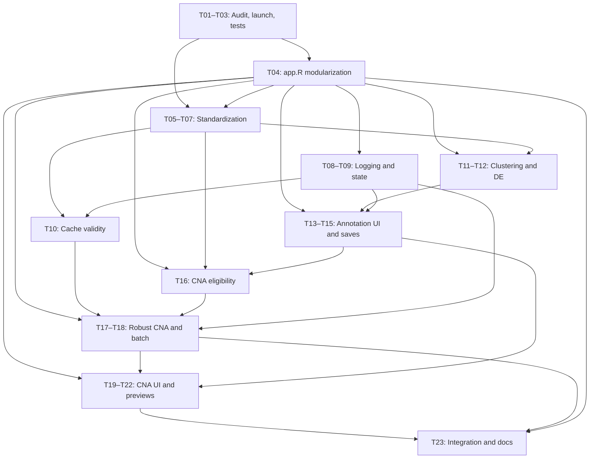
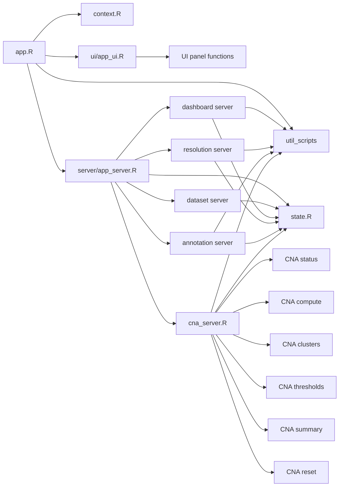

# scAnnotationPipeline — Development Plan

**Document purpose.** This is the working implementation plan for changes identified during a manual end-to-end test of the scAnnotationPipeline on the `Che2021_Colorectal` dataset. It groups issues into actionable tasks, records their priority, complexity, dependencies, and required tests, and defines a suggested order of implementation. **Section 10 (Progress Tracker)** and **Section 11 (Progress Notes & Additional Information)** are living sections to be updated as work proceeds. This document plans changes; it does not imply that the code changes have been implemented.

**Initial plan date:** 2026-10-14  
**Last progress update:** 2026-10-21  
**Current phase:** Milestones 0–7 and all 23 tasks complete  
**Basis:** Manual testing notes plus source inspection and automated baseline validation against the current repository and `Che2021_Colorectal` workspace.

---

## 1. Scope and planning principles

The objective is to improve **reliability, reproducibility, and usability** of the existing semi-automatic cancer scRNA-seq cell-type annotation workflow, without unnecessarily redesigning stages that already work.

Work is grouped into three priorities:

| Priority | Meaning | Examples |
| --- | --- | --- |
| **P0 — Critical** | Correctness, data integrity, reproducibility, crash prevention, or reliable recovery | Input contracts, CNA eligibility, safe caching, saved workflow states |
| **P1 — Important** | Missing or inconsistent core workflow behavior | Completion feedback, annotation navigation, batch processing controls |
| **P2 — Improvement** | Nonblocking presentation, documentation, and interaction refinements | Startup warning, plot titles, sample notes, threshold UI simplification |

**Complexity estimates** are relative rather than calendar commitments: **S** = localized change; **M** = multi-function/module change; **L** = cross-cutting or analytically significant change; **XL** = large, architecture-wide refactor requiring multiple incremental changes and integration tests. Re-estimate after inspecting the implementation.

**Implementation rules:**
- Perform the required `app.R` structural refactor early, but as small, reviewable, behavior-preserving extractions rather than a single all-at-once rewrite.
- Add regression tests with each change, not only at the end.
- Preserve existing datasets and working navigation behavior whenever possible.
- Make failures actionable: show what failed, for which sample, and how to recover.
- Distinguish a *sample that is ineligible for a step* from a *failed computation* and an *unfinished manual decision*.
- Never treat partially written or outdated cached outputs as valid results.
- Mark hypotheses as hypotheses until verified in code or reproduced in tests.

## 2. Suggested implementation timeline

The order below is **dependency-based**, not a calendar schedule. The early `app.R` refactor is a prerequisite for most application-level changes, particularly UI reactivity, navigation, step state, progress reporting, and CNA execution. The standardization data contract itself can be designed independently, but implementation should follow the refactor where application readers/builders are involved.

| Order | Milestone | Task IDs | Main outcome | Gate before proceeding |
| --- | --- | --- | --- | --- |
| 0 | **Baseline and architecture** | T01–T03 | Reproducible failure cases and test framework; investigate app launch | Existing behavior, source/loading strategy, state, and cache locations understood |
| 1 | **`app.R` modularization** | **T04** | Thin app entry point; UI and server logic separated into coherent components | Existing behavior preserved and tests pass after each extraction |
| 2 | **Standardization contract** | T05–T07 | Stable schema, validators, and reusable guide/template | Valid standardized outputs; old datasets checked |
| 3 | **Shared workflow infrastructure** | T08–T10 | Persistent logs, step states, cache rules | State transitions and cache invalidation tested |
| 4 | **Clustering, DE, annotation** | T11–T15 | Correct first-sample behavior and safe annotation interactions | Valid annotation state can be saved/reloaded |
| 5 | **CNA reliability** | T16–T18 | Preflight gate, numerical safeguards, safe batch processing | Invalid samples do not crash or poison a batch |
| 6 | **CNA interface and inspection** | T19–T22 | Progress feedback and trustworthy plot/selection UI | Plot-to-selection mapping and previews verified |
| 7 | **Integration and release readiness** | T23 | Full end-to-end regression and documentation | Acceptance criteria in Section 9 met |

**Parallel opportunities:** T02 (launch/autoload investigation) should inform T04. The standalone standardization guide and validator design (T06–T07) can be developed alongside the refactor, provided app-facing integration waits for the new structure. Small presentation changes should generally wait until the affected UI/server code is extracted, to avoid modifying it twice.

## 3. Dependency map



**Primary critical path:** baseline and regression tests → `app.R` modularization → stable data/annotation contracts → CNA eligibility → robust CNA computation and batching → final integration. Logging, status management, and cache validity support the analytical path and should be introduced early.

**Refactor constraint:** T04 is a structural dependency for app-facing work, *not* permission to change analytical behavior. Any discovered bug should be characterized by a test and fixed in its designated subsequent task unless it prevents the refactor itself.

## 4. Milestone 0 — Baseline and architecture

| ID | Priority | Complexity | Task | Dependencies |
| --- | --- | --- | --- | --- |
| **T01** | P0 | M | Inspect module boundaries, data flow, per-step state, existing logs, caches, and navigation; reproduce reported failures | None |
| **T02** | P1 | S–M | Investigate Shiny `warn_if_app_dir_is_package()` warning and choose a package-aware launch/autoload strategy before restructuring sources | T01 |
| **T03** | P0 | M | Establish repeatable `testthat` utility tests, `shinytest2` UI tests where useful, and minimal fixture datasets | T01 |

**Investigation checklist (T01):**
- Identify where `app.R`, utility scripts, validators, sample builders, standardization script, and documentation read/write files.
- Trace which outputs are cached and how cache success is currently determined.
- Locate any existing definitions of step completion, stale outputs, and saved user decisions.
- Record reproduction steps for `symbol` error, first-sample `min_genes` error, initial manual-annotation plot load, CNA numerical failures, and faulty cache reuse.

**Acceptance:** At least one small test fixture runs independently of the full dataset. Existing state and cache mechanisms have been mapped before introducing new ones. For T02, the safe loading strategy is established (and the warning resolved by T02/T04) without breaking function loading. Preserve baseline screenshots, outputs, and core UI interactions for refactor comparison.

### 4.1 Milestone 0 baseline findings (2026-10-14)

#### Current boundaries and data flow

| Area | Current implementation | Refactor implication |
| --- | --- | --- |
| App bootstrap | `app.R` reads `general_config.yaml`, explicitly sources the five numbered files in `util_scripts/`, loads all shared resources, defines the UI and server, and calls `shinyApp()` | Keep configuration/resource initialization explicit; move UI and server registration out incrementally |
| UI | All navbar panels and controls are defined inline in `app.R`; input/output IDs are global | Capture IDs and representative views before extraction; preserve IDs during T04 |
| Server/state | One server function owns 48 `observeEvent()` handlers, two broad `observe()` handlers, 54 referenced inputs, 21 outputs, and a shared `reactiveValues()` object | Extract by stage while passing shared state explicitly; watch nested dynamic observers in the CNA threshold UI |
| Utility code | `01_utils_io.R` loads standardized files; `02_utils_annotation.R` holds analysis/plot functions; `03_utils_misc.R` holds config/validation/builders; `04_utils_caching.R` wraps `qs2`; `05_utils_workflow.R` orchestrates clustering, DE, annotation, and CNA | Existing utility boundaries are usable, but some functions still rely on packages attached by `app.R` |
| Primary flow | `processed_data/<sample>` (`Cells.csv`, `Genes.txt`, Matrix Market expression) → filtered/clustering `.qs2` caches and cluster plots → DE tables/plots → manual annotations → CNA caches/plots/final cell assignments | Preserve filenames and formats through T04; contract and invalidation changes belong to later milestones |
| Durable decisions | Resolution and CNA choices live in `selected_config.yaml`; annotation saves update the resolution-specific cell cache and standardized `Cells.csv` | There is no general persisted workflow-state model yet |
| Cache success | Cache files live in `<dataset>/cache`; current reuse generally checks filename existence, then reads the object | No manifest, input/parameter fingerprint, schema validation, atomic commit marker, or stale-state tracking exists |
| Logging/status | Console `message()`/warnings and transient Shiny notifications are used | No persistent structured event log or coherent cross-session step status exists |

The current source/loading decision for T02 is to keep `DESCRIPTION` for development tooling, keep explicit utility sourcing, sort the source list for deterministic order, and place Shiny's supported `R/_disable_autoload.R` sentinel in the repository. This prevents Shiny from treating the package metadata as a request to autoload `R/`, eliminates `warn_if_app_dir_is_package()`, and avoids loading helpers twice when T04 adds app component files. New app components should therefore be registered explicitly by the app bootstrap rather than implicitly placed in `R/`.

#### Failure/reproduction baseline

| Reported issue | Current result | Evidence / follow-up |
| --- | --- | --- |
| Cancer marker `object 'symbol' not found` | **Reproduced** | `resources/malignant_markers.csv` exposes `gene`; the dataset-load branch renames `cancer_type` but later selects `symbol` without first renaming `gene`. Fix remains assigned to T11. |
| First-sample empty `min_genes` message | **Not reproduced in current tree** | Loading the alphabetically first Che2021 sample (`COL07_liver_metastasis`) with the current configuration succeeded with a 5,384 × 14,648 filtered matrix. `load_filter_cells_expmat()` now includes an explicit empty-result error containing the configured value. Add a server-initialization regression in T11 before declaring the UI issue resolved. |
| Initial manual-annotation plot load | **Not reproduced in current tree** | The Edge-driven UI baseline loads the first Che2021 annotation view and captures both the UMAP and cluster-score plot without navigating away and back. Preserve the screenshot and retest during T04/T13. |
| CNA empty/non-finite and undersized clustering failures | **Reproduced and characterized** | Tests record empty-reference `Inf`/`-Inf` output, non-finite correlation failure, and the single-object `hclust` failure. Controlled eligibility/errors remain for T16–T17. |
| Faulty cache reuse | **Resolved in T10** | Cache reuse now requires a tracked manifest record, checksum/size match, structural/numeric validation, and matching dependency fingerprint; recovery or recomputation replaces existence-only reuse. |

#### Test baseline

- The repository already contained a substantial `testthat` utility/integration suite, deterministic synthetic fixture builders, and a CNA golden fixture; this was more advanced than the original plan snapshot indicated.
- The root command `Rscript tests/testthat.R` was repaired and now runs the intended `tests/testthat` directory.
- On R 4.5.3, the non-browser suite is **224 passed, 0 failed, 0 warned**, with the browser journey intentionally skipped unless `NOT_CRAN=true`. Coverage includes clustering, DE, cache, CNA, golden outputs, app bootstrap, and Milestone 0 failure characterizations.
- R 4.5.2 on this workstation has a broken `stringfish` shared-library dependency, causing `qs2` to be unavailable and 17 cache-dependent tests to skip. This is an environment issue rather than a test assertion failure; use the working R 4.5.3 environment or repair the R 4.5.2 binary installation before relying on that runtime.
- `shinytest2` 0.5.1 is configured to use Microsoft Edge through `CHROMOTE_CHROME`. The read-only Che2021 journey has **21 passing assertions** across launch, dataset load, resolution selection, manual annotation, and CNA navigation, with five Windows/R 4.5 baseline screenshots. Observer-once checks remain a T04 parity guardrail as handlers are extracted.

## 5. Milestone 1 — Modularize `app.R` before feature changes

| ID | Priority | Complexity | Task | Dependencies |
| --- | --- | --- | --- | --- |
| **T04** | **P0** | **XL** | Refactor the bloated `app.R` into coherent, independently navigable files/modules while preserving existing Shiny behavior, reactive state, data flows, and pipeline outputs | T01–T03 |

### Purpose and boundaries (T04)

The current monolithic `app.R` makes it difficult to locate UI/server code, understand cross-stage dependencies, and implement fixes safely. This refactor therefore comes immediately after the baseline and testing setup. **The goal is maintainability without functional change.** Do not combine it with new logging, annotation semantics, or CNA algorithm fixes; those have their own tasks after the structural migration.

**Proposed organization — confirm during T01/T04 rather than treating as a fixed design:**

- Keep `app.R` small: configuration, application initialization, source/module registration, and app startup.
- Extract reusable layout/UI definitions and shared controls from server-side computation.
- Organize UI and server handlers by pipeline area (dataset setup/standardization, clustering/resolution, bulk DE, manual annotation, CNA stages, and summary).
- Centralize genuinely shared reactive values, sample selection, navigation, status, and file path interfaces. Preserve existing dependencies; introduce explicit interfaces before converting heavily shared observers into Shiny modules.
- Keep analytical functions in appropriate utility files rather than duplicating them in UI code.
- Decide whether to use sourced helper files, Shiny modules, or a gradual combination based on the existing reactive structure. Do not force full Shiny module conversion when a safer extraction suffices.
- Coordinate with T02 so the chosen file layout does not trigger duplicate source loading or Shiny's package-directory autoload warning.

### T04 concrete component design (proposed 2026-10-14)

Use explicitly sourced app components under a new `app/` directory. Do **not** convert the first extraction to namespaced Shiny modules: adding `NS()`/`moduleServer()` would change DOM IDs, complicate snapshot comparison, and combine structural extraction with a reactivity redesign. Each server file should instead expose a registration function that receives the existing `input`, `output`, `session`, shared reactive state, and immutable app context. Full module conversion can be evaluated later, stage by stage, after behavior parity is established.

```text
app.R
app/
├── context.R
├── state.R
├── ui/
│   ├── dataset_ui.R
│   ├── dashboard_ui.R
│   ├── resolution_ui.R
│   ├── annotation_ui.R
│   ├── cna_ui.R
│   └── app_ui.R
└── server/
    ├── dataset_server.R
    ├── dashboard_server.R
    ├── resolution_server.R
    ├── annotation_server.R
    ├── cna_status_server.R
    ├── cna_compute_server.R
    ├── cna_cluster_server.R
    ├── cna_threshold_server.R
    ├── cna_summary_server.R
    ├── cna_reset_server.R
    ├── cna_server.R
    └── app_server.R
```

`app/` is deliberately separate from the package-convention `R/` directory. Shiny implicit `R/` loading remains disabled by `R/_disable_autoload.R`; `app.R` will contain an explicit, ordered component manifest so source order is reviewable and testable.

#### File responsibilities and public interfaces

| File | Intended content / interface |
| --- | --- |
| `app.R` | Attach the four app-level packages currently attached there; source sorted utility files; source an explicit ordered list of app component files; build `context`, `ui`, and `server`; call `shinyApp()`. Target: roughly 30–50 lines. |
| `app/context.R` | `create_app_context(config_path = "general_config.yaml")`: validate the working directory and resources, read general config and immutable resource tables/text, prepare gene-position/HGNC data exactly as today, discover initial datasets, and return one non-reactive context list. No session state. |
| `app/state.R` | `create_app_state(context)`: create the single flat `reactiveValues()` object with all current mutable fields, including `cna_preview_res` explicitly. Document which stage owns each field. Do not introduce nested state or new workflow semantics in T04. |
| `app/ui/dataset_ui.R` | `dataset_selection_panel(available_datasets)`: current Dataset Selection panel and unchanged IDs. |
| `app/ui/dashboard_ui.R` | `dashboard_panel()` and `reference_panel(clipboard_text)`: current Start Menu and Reference Data panels. |
| `app/ui/resolution_ui.R` | `resolution_panel(sample_choices)`: current resolution sidebar and output placeholders. |
| `app/ui/annotation_ui.R` | `annotation_panel(sample_choices)`: current manual-annotation sidebar, tabs, and output placeholders. |
| `app/ui/cna_ui.R` | `cna_panel(sample_choices)`: current CNA sidebar and hidden step views. Keep all current IDs and nav values. |
| `app/ui/app_ui.R` | `build_app_ui(context)`: assemble `page_navbar()`, theme/header, and the six panel functions in the current order. |
| `app/server/dataset_server.R` | `register_dataset_server(input, output, session, state, context)`: dataset load/change/create handlers, dataset-path assembly, dataset-specific marker preparation, state population, sample-choice updates, and initial tab visibility. Preserve the known marker warning for T11 rather than fixing it during extraction. |
| `app/server/dashboard_server.R` | `register_dashboard_server(...)`: menu/reference navigation, prompt selection, clustering confirmation/execution, and bulk-DE confirmation/execution. |
| `app/server/resolution_server.R` | `register_resolution_server(...)`: four resolution outputs, resolution save/advance behavior, and targeted DE rerun. |
| `app/server/annotation_server.R` | `register_annotation_server(...)`: sample/cluster navigation, annotation-data loading, dynamic controls, reference/marker plots and table, assignment preview, annotation save, and CNA reference/candidate configuration. |
| `app/server/cna_status_server.R` | `register_cna_status_server(...)`: CNA sample selector population, sample switching, header/status output, button enable/disable rules, and CNA subview navigation. |
| `app/server/cna_compute_server.R` | `register_cna_compute_server(...)`: individual CNA/heatmap computation plus batch confirmation/execution. |
| `app/server/cna_cluster_server.R` | `register_cna_cluster_server(...)`: debounced `k`, the static heatmap reactive, combined heatmap renderer, malignant-cluster choices, save/cleanup logic, and signal/correlation computation. Return or retain its private reactives inside this registration boundary. |
| `app/server/cna_threshold_server.R` | `register_cna_threshold_server(...)`: dynamic subclone tabs/sliders, plot renderers, slider coupling observers, threshold validation/save, and threshold plot persistence. |
| `app/server/cna_summary_server.R` | `register_cna_summary_server(...)`: preview generation/rendering and final assignment/plot saves. Own `state$cna_preview_res`. |
| `app/server/cna_reset_server.R` | `register_cna_reset_server(...)`: reset confirmation, configuration/cache/plot cleanup, cell-label restoration, and UI refresh. |
| `app/server/cna_server.R` | `register_cna_server(...)`: compose the six CNA registration functions only; contain no analytical implementation. |
| `app/server/app_server.R` | `build_app_server(context)`: return the Shiny server function, create shared state, apply initial navbar visibility, and register dataset, dashboard, resolution, annotation, and CNA handlers once each. |

The analytical functions in `util_scripts/` remain in place. T04 may move app-only orchestration code but must not relocate or rewrite clustering, DE, annotation scoring, CNA algorithms, caching semantics, or validation behavior.

#### Context and shared-state contract

```text
immutable context
├── config                      general_config.yaml
├── paths                       resource, dataset, and template roots
├── resources
│   ├── marker_genes
│   ├── malignant_markers
│   ├── housekeeping_genes
│   ├── mt_genes
│   ├── cancer_cell_map
│   ├── clipboard_text
│   ├── hgnc_complete_set
│   └── gene_positions
└── available_datasets          startup choices

shared reactive state
├── dataset/session
│   ├── paths_list
│   ├── dataset_config
│   ├── samples_config
│   ├── live_selected_config
│   ├── selected_config_path
│   ├── dataset_dir_path
│   ├── results_dir_path
│   ├── complete_markers
│   └── config                  general config plus selected config, as today
├── annotation
│   ├── cells_filt
│   ├── cells_raw
│   ├── all_matches
│   ├── sample_name
│   ├── res
│   └── final_plot
└── CNA
    └── cna_preview_res
```

Keep the state flat during T04 so existing `state$field` dependency behavior is preserved. Immutable resources should leave reactive state: `gene_positions`, `cancer_cell_map`, and `clipboard_text` belong in `context`, not in `reactiveValues()`. Component registration must occur exactly once per session. Dynamic threshold observers remain within `cna_threshold_server.R` initially and receive dedicated observer-count coverage when extracted.

#### Dependency direction



Dependencies flow from orchestration to leaf components and utilities. UI files must not source server files; stage server files must not source one another directly; all sourcing is owned by `app.R`. Cross-stage communication continues through the documented shared state and saved artifacts, not calls into another stage's observer-registration function.

#### Planned extraction checkpoints

1. **Add the component manifest and context/state factories.** Move startup resource loading into `context.R`, initialize the documented state in `state.R`, and keep the existing inline UI/server temporarily. Verify clean launch, the bootstrap test, 224 non-browser assertions, and 21 browser assertions.
2. **Extract static UI leaf functions.** Move one panel at a time in this order: dataset/reference/dashboard → resolution → annotation → CNA; then add `app_ui.R`. Compare all five screenshots and confirm every existing input/output ID and nav value is unchanged.
3. **Extract the server shell and low-coupling handlers.** Add `app_server.R`, then move dataset/dashboard and resolution registrations. Verify dataset load, navigation, resolution display/save test coverage, and no duplicate handler execution.
4. **Extract annotation handlers as one coherent boundary.** Preserve sample/cluster state and first-view rendering. Run the annotation screenshot and existing annotation tests before proceeding.
5. **Extract CNA incrementally.** Move status/navigation, compute, cluster selection, thresholds, summary, and reset in that order. Run the full non-browser suite after every file; run the Edge journey after every visible step; add observer-once assertions around the dynamic threshold registration.
6. **Reduce and document `app.R`.** Leave only package attachment, explicit manifests/sourcing, context construction, and Shiny startup. Add a short component map to README/USER_GUIDE and run the complete baseline plus representative old-dataset loading.

Each checkpoint should be its own reviewable commit. If moving a block requires changing an ID, file format, cache key, analytical result, or user-facing behavior, stop and defer that change to its assigned later task rather than folding it into T04.

### Incremental extraction sequence

1. **Capture baseline:** list all observers, reactive values, inputs/outputs, file side effects, and start-up sourcing order. Record representative UI flows and computation outputs.
2. **Define boundaries:** decide file/module naming, initialization order, ownership of shared state, event interfaces, and source/namespace rules. Draw a simple module dependency graph.
3. **Extract low-risk code first:** UI definitions, static helpers, repeated widgets, and self-contained handlers. Keep external IDs and data formats unchanged.
4. **Extract stage-specific server logic incrementally:** clustering/DE, annotation, and CNA handlers. Pass dependencies explicitly where practical, and avoid circular imports or implicit global variables.
5. **Reduce `app.R` to orchestration:** all pipeline stages remain wired, with predictable startup and documented file layout.
6. **Run parity tests after each extraction**, then repeat a representative end-to-end workflow before starting functional changes.

### Refactor-specific risks and required checks

| Risk | Required guardrail / test |
| --- | --- |
| Reactivity or observer registration changes | UI test: changing dataset/sample triggers the same outputs and observers exactly once |
| Shared values move out of scope | Test cross-stage transitions, saved selections, and reactive invalidation |
| Duplicate sourcing or autoload | Clean startup test; ensure files/functions are loaded once with the correct environment |
| Changed input/output IDs or namespaces | Compare UI behavior and bindings with the recorded baseline |
| Path or working-directory assumptions | Launch from a clean environment and verify existing paths/files remain correct |
| Functional drift during extraction | Separate refactor-only changes from subsequent bug fixes; compare representative saved outputs |
| Existing dataset compatibility | Open old completed datasets and verify existing panels/results can still load |

**Acceptance:** `app.R` is a compact entry/orchestration script; responsibilities and shared reactive interfaces are documented; source loading is deterministic; baseline clustering → DE → annotation → CNA navigation still works; representative outputs/files are unchanged; regression tests pass; no user-visible workflow regression is introduced.

---

## 6. Milestone 2 — Standardization contract

| ID | Priority | Complexity | Task | Dependencies |
| --- | --- | --- | --- | --- |
| **T05** | P0 | M | Make `sample` the canonical sample ID in config templates, builders, scripts, and relevant app readers; inspect `id` usage and compatibility | T01, T04 |
| **T06** | P0 | L | Strengthen pre-/postvalidation and document data invariants for sample files, identifiers, expression scale, and matrix alignment | T05 |
| **T07** | P1 | M | Create a general standardization R template plus a dedicated checklist-style guide, allowing dataset-specific loading and splitting | T05, T06 |

### Standardized data contract (T05–T06)

| Item | Required check / policy to formalize |
| --- | --- |
| Sample config | Prevalidation passes before generating standardized sample outputs |
| Sample ID | Canonical column is `sample`; config IDs match sample folders/files and cell-to-sample assignment |
| Legacy config | The former `id` key is unsupported; migrate files to `sample` and fail immediately if `id` appears |
| Expression matrix | Clearly identify UMI counts versus TPM; ensure downstream processing accepts the chosen scale |
| Sample separation | Each cell is assigned to the correct sample and each required sample has outputs |
| Cell identifiers | Unique within sample; dataset-wide uniqueness preferred if downstream merging assumes it |
| Gene identifiers | Valid gene symbols and a documented, reproducible duplicate/missing-symbol policy; discard only with corresponding matrix-row changes |
| Matrix alignment | Matrix rows and columns match `Genes.csv` and `Cells.csv` respectively, including ordering |
| Completeness | Every sample contains the expected files and valid dimensions |
| Final validation | Postvalidation passes before clustering begins |

**Important open decision:** Do not automatically assume every duplicated gene symbol is dispensable. Choose and document a consistent handling policy after evaluating actual input cases.

### Standardization guide/template (T07)

1. Inspect raw data, gene naming, count type, sample structure, and accompanying metadata.
2. Complete sample configuration and pass **prevalidation**.
3. Perform dataset-specific extraction, loading, checking, and splitting in user-authored code.
4. Normalize identifiers and align cells, genes, and matrix dimensions.
5. Use reusable template helpers to write per-sample `Cells.csv`, `Genes.csv`, and matrix outputs, plus dataset-wide sample metadata.
6. Run **postvalidation**, correct reported failures, and rerun validation.
7. Aim for one script that reproduces the standardized dataset from the raw inputs without manual intermediate fixes.

**Tests:** `sample`-only config; rejection of the former `id` key; duplicate gene/cell names; missing genes; matrix size/order mismatch; absent sample files; valid count or TPM input; full Che2021_Colorectal standardization replay.

## 7. Milestone 3 — Logs, step states, and caches

| ID | Priority | Complexity | Task | Dependencies |
| --- | --- | --- | --- | --- |
| **T08** | P0 | L | Introduce persistent structured logging of processing actions, parameters, user decisions, skipped samples, warnings, and errors | T04 |
| **T09** | P0 | L | Define and persist coherent per-dataset/per-sample pipeline step states, including incomplete and not-done flags | T04, T08 |
| **T10** | P0 | L | Establish cache metadata, validity checks, dependency-aware invalidation, atomic writes, and failure recovery | T06, T09 |

### Logging design (T08)

Capture at least: timestamp, dataset, sample (when applicable), stage, event type, parameters or relevant version, outcome, and an actionable reason on failure/skip. Console output remains useful, but a persistent event history must not depend on console availability.

Relevant events include: standardization validated, clustering started/finished, resolution saved, DE completed, annotations saved/changed, CNA skipped/configured/started/finished/failed, thresholds saved, cache reused/invalidated, and manual sample notes updated.

Prefer a readable log plus a structured append-only representation if practical. Avoid logging excessive cell-level data or private paths when not necessary.

### Workflow state model (T09)

Application step states should distinguish:

| Step status | Meaning |
| --- | --- |
| `not_started` | No attempt or saved decision yet |
| `in_progress` | Currently executing |
| `incomplete` | Started, but required input or manual action is missing |
| `completed` | Required decisions and validated outputs are saved |
| `skipped` | Explicitly or automatically excluded, **with reason** |
| `failed` | Attempted operation could not complete |
| `stale` | Previously valid output depends on changed upstream input |

**Design constraint:** Saving cell-type annotation without CNA configuration is possible but is not automatically equivalent to explicitly skipping CNA.

#### T09 implementation plan

##### Persistence and ownership

- Add `pipeline_state.yaml` to each dataset workspace and register it as
  `config_files$state` in `general_config.yaml`.
- Keep `selected_config.yaml` limited to user selections such as resolutions,
  CNA cell types, clusters, and thresholds.
- Keep `logs/pipeline_events.jsonl` append-only as the complete chronological
  history. `pipeline_state.yaml` is only the latest current-state snapshot and
  must never replace, truncate, or reconstruct the event history.
- Treat generated files and caches as artifacts, not as authoritative workflow
  state. T10 adds artifact fingerprints and cache-validity enforcement.

The initial state document will use this shape:

```yaml
schema_version: 1
dataset_id: Example_Dataset
revision: 12
updated_at: 2026-10-14T12:34:56.000Z
dataset_steps:
  standardization:
    status: completed
    attempt: 1
    started_at: null
    finished_at: 2026-10-14T10:00:00.000Z
    updated_at: 2026-10-14T10:00:00.000Z
    reason: null
    details:
      sample_count: 3
samples:
  sample1:
    clustering:
      status: completed
      attempt: 1
      started_at: 2026-10-14T10:10:00.000Z
      finished_at: 2026-10-14T10:15:00.000Z
      updated_at: 2026-10-14T10:15:00.000Z
      reason: null
      details: {}
    resolution:
      status: completed
      attempt: 1
      started_at: null
      finished_at: 2026-10-14T10:20:00.000Z
      updated_at: 2026-10-14T10:20:00.000Z
      reason: null
      details:
        resolution: 0.5
```

Every step record has `status`, `attempt`, timestamps, an optional actionable
`reason`, and small reproducibility-oriented `details`. It does not contain
large objects, cell-level data, or a duplicate history of old states.

##### Step inventory

| Scope | Step key | Completion boundary |
| --- | --- | --- |
| Dataset | `standardization` | Strict postvalidation succeeds |
| Sample | `clustering` | Filtered-expression and all configured resolution results are written |
| Sample | `resolution` | A resolution is saved to `selected_config.yaml` |
| Sample | `differential_expression` | Marker matches and DE plots for the selected resolution are written |
| Sample | `annotation` | Cell annotations are saved to `Cells.csv` and the selected-resolution cache |
| Sample | `cna_configuration` | Required reference/candidate decisions are saved, or a later task records an explicit skip |
| Sample | `cna_compute` | Base CNA and clustering/heatmap outputs complete |
| Sample | `cna_cluster_selection` | Malignant subclone candidates are saved |
| Sample | `cna_signal_correlation` | All selected subclone signal/correlation outputs complete |
| Sample | `cna_thresholds` | Valid thresholds are saved for all selected subclones |
| Sample | `cna_assignment` | Final CNA assignments and summary outputs are saved |

##### Transition rules

Use the seven statuses already defined for T09. Enforce transitions through one
utility rather than assigning status strings directly:

| Current | Normally allowed next states |
| --- | --- |
| `not_started` | `in_progress`, `incomplete`, `completed`, `skipped` |
| `in_progress` | `completed`, `incomplete`, `failed`, `skipped` |
| `incomplete` | `in_progress`, `completed`, `skipped`, `stale` |
| `completed` | `in_progress`, `stale` |
| `failed` | `in_progress`, `incomplete`, `skipped` |
| `skipped` | `in_progress`, `stale` |
| `stale` | `in_progress`, `incomplete`, `skipped` |

- Require a non-empty reason for `incomplete`, `failed`, `skipped`, and
  `stale`.
- Increment `attempt` only when entering `in_progress` from another status.
- A direct `completed` transition is allowed for atomic saved decisions such as
  resolution selection.
- Re-saving an unchanged decision updates its timestamp/details but does not
  make downstream steps stale.
- Invalid transitions and unknown step/status names hard-fail before modifying
  disk or reactive state.

Missing prerequisites are `incomplete`, not `skipped`. `skipped` is reserved
for an explicit user decision or a validated automatic exclusion with a reason;
T14/T16 will provide the complete CNA skip/eligibility UI.

##### Dependency and staleness rules

State invalidation is sample-scoped unless standardization changes the whole
dataset:

```text
standardization
  -> clustering -> resolution -> differential_expression -> annotation
                                                        -> cna_configuration
annotation + cna_configuration
  -> cna_compute -> cna_cluster_selection
  -> cna_signal_correlation -> cna_thresholds -> cna_assignment
```

Apply these concrete rules:

- A successful repeat standardization conservatively marks every sample step
  stale. T10 avoids physical cache invalidation when fingerprints prove inputs unchanged.
- Re-running clustering marks resolution and every downstream sample step
  stale.
- Changing the selected resolution marks DE, annotation, and all CNA steps
  stale for that sample only. Saving the same resolution does not.
- Re-running DE marks annotation and all CNA steps stale because the evidence
  used for annotation changed.
- Saving changed annotations marks CNA computation and all later CNA steps
  stale.
- Changing CNA reference/candidate configuration marks CNA computation and all
  later CNA steps stale.
- Changing malignant-cluster selection marks signal/correlation, thresholds,
  and final assignments stale.
- Changing thresholds marks only final CNA assignment stale.
- Resetting CNA retains a valid CNA configuration but returns CNA computation
  and every later CNA step to `not_started`.

T09 marks invalidated work as stale and prevents downstream actions from being
presented as complete. Physical cache deletion, content validation, and safe
reuse are implemented by T10.

##### State API and integration points

Create `util_scripts/07_utils_state.R` with pure validation/transition helpers
and narrow persistence functions:

- `new_pipeline_state(dataset_id, sample_names)`;
- `validate_pipeline_state(state, dataset_id, sample_names)`;
- `load_or_initialize_pipeline_state(...)`;
- `save_pipeline_state_atomic(...)`;
- `get_pipeline_step(...)` and `transition_pipeline_step(...)`;
- `mark_pipeline_steps_stale(...)` using a single declared dependency map;
- `reconcile_pipeline_state_samples(...)` for added/removed configured samples.

Writes must use a same-directory temporary file, validate the serialized YAML,
and retain/recover a backup if replacement is interrupted. Serialize mutations
through a short-lived dataset-local lock, reread the latest revision before
editing, and increment `revision` on every successful write.

Application integration:

1. Add `pipeline_state` and `pipeline_state_path` to the flat Shiny session
   state and load them with the dataset.
2. Initialize the file during new-workspace creation and after successful
   standardization.
3. Update state at start/success/failure boundaries for clustering, DE, and CNA
   computation; update state after atomic decision saves for resolution,
   annotation, CNA configuration, cluster selection, thresholds, and final
   assignment.
4. Refactor bulk clustering/DE orchestration to report per-sample boundaries so
   an error does not ambiguously mark already-completed samples.
5. Render resolution/annotation/CNA badges from persisted state rather than
   cache existence alone. Display stale, failed, skipped, and incomplete with
   their reason.
6. Guard downstream actions when prerequisite state is not completed or
   explicitly skipped where allowed.
7. Append the existing domain event after each state change; if state
   persistence fails after scientific output was written, emit a logging
   failure/warning and present a recovery action rather than silently claiming
   completion.

##### Existing-dataset migration

- New workspaces start with standardization and every sample step as
  `not_started`.
- When `pipeline_state.yaml` is absent, create a version-1 document using a
  conservative one-time legacy inference from `selected_config.yaml` and
  required artifacts. Mark inferred records with
  `details.provenance: legacy_inference`.
- Do not infer completion from the event log alone and do not claim CNA
  completion from one cache file. Ambiguous partial artifacts become
  `incomplete` with an explanation.
- Reconcile configured sample names at load. Add new samples as `not_started`;
  preserve removed-sample history in the append-only log rather than retaining
  it as active state.
- Reject unsupported future schema versions with a clear migration error.

##### Tests and acceptance

Unit tests must cover:

- exact schema initialization and validation;
- every allowed and rejected transition;
- required reasons and deterministic timestamps;
- attempt/revision increments and repeat-run behavior;
- same-value versus changed-value resolution saves;
- sample-scoped and dataset-wide staleness propagation;
- atomic save/reload, interrupted replacement recovery, corrupt primary file,
  and stale lock recovery;
- existing-dataset migration and added/removed sample reconciliation;
- persistence across a fresh R/Shiny session;
- confirmation that repeated transitions append log events without changing or
  truncating earlier log lines.

Integration/component tests must cover clustering and bulk-DE per-sample
states, a changed resolution followed by single-sample DE, annotation/CNA
dependency invalidation, CNA reset, prerequisite guards, and all UI badge
renderings. Rerun the full non-browser suite and the Edge baseline; update a
visual baseline only for an intentional reviewed state-display change.

T09 is complete when current state survives restart, repeated work produces
correct per-sample transitions, stale downstream work is visibly distinguished
from incomplete/skipped/failed work, and no status is derived solely from cache
existence. T10 now supplies cache fingerprints and safe physical invalidation.

### Cache validity model (T10)

A cache should be reused only if required artifacts are present, loadable, structurally/numerically valid, and linked to matching inputs, parameters, and upstream decision versions. Partial computations should use temporary files and be marked valid only after successful completion. A failed cache should be safely recomputed or ignored, never used as valid analysis input.

Examples of invalidation edges (verify against real implementation):
- Expression data changes → all dependent steps stale.
- Clustering/resolution changes → cluster-dependent DE, annotation, and downstream steps stale.
- Annotation changes → affected CNA eligibility and CNA-dependent results stale.
- CNA configuration changes → CNA computation and its downstream results stale.
- Malignant cluster selection changes → signal/correlation, threshold results, final assignment stale.
- Threshold changes → final assignment and previews stale.

**Tests:** restart persistence; transitions into `incomplete`/`skipped`/`stale`; changed-input invalidation; interrupted write; corrupt cache; previous failure then correct rerun; avoidance of unnecessary recomputation when cache remains valid.

**Implemented contract (2026-10-16):** Each `.qs2` artifact is registered in a
revisioned `cache_manifest.yaml` with checksum, size, artifact-specific
validation, dependencies, and a dependency fingerprint. Artifact and manifest
writes use same-directory temporary files and retain one recoverable prior
version. Clustering fingerprints standardized inputs and relevant parameters;
CNA artifacts fingerprint upstream artifact versions and saved decisions.
Resolution, annotation, CNA-configuration, malignant-cluster, and reset actions
perform manifest-aware physical invalidation. Dataset loading reconciles
completed workflow state against cache validity and marks invalid or legacy
untracked work stale. Full details are in `docs/CACHE_VALIDITY.md`.

## 8. Milestone 4–6 — Workflow and CNA improvements

### Milestone 4: clustering, DE, and manual annotation

| ID | Priority | Complexity | Task | Dependencies |
| --- | --- | --- | --- | --- |
| **T11** | P0 | M | Diagnose first-sample `min_genes = ` loading error and cancer-type-specific marker `object 'symbol' not found`; distinguish UI initialization from data issues | T04, T06 |
| **T12** | P1 | S | Add completion feedback after clustering (return to GUI to select resolution) and after bulk DE | T04, T08 |
| **T13** | P1 | M | Fix initial manual-annotation plot loading; reset to Cluster Exploration on next sample; open preview after Preview Annotation; shorten plot titles | T04 |
| **T14** | P0 | M–L | Detect unsaved annotation edits and confirm navigation; require explicit acknowledgement for save without CNA configuration, while allowing intentional omission | T04, T09 |
| **T15** | P2 | M | Add persistent per-sample notes, visible/editable across pipeline stages; polish annotation plot title/subtitle | T04, T08, T09 |

**T11 diagnostic details:** The displayed empty `min_genes` parameter suggests the value may be uninitialized when the first sample loads, but the cause must be checked. Ensure a genuinely empty/misaligned sample still produces an informative validation failure. For missing `symbol`, validate marker-table schema before cancer-type-specific marker addition; supply a controlled fallback or actionable error as appropriate.

**T13 expected navigation:** after switching samples, show **Cluster Exploration**; clicking **Preview Annotation** switches to the preview; first-sample plots load immediately after DE without navigating away and back. Put sample name in main plot title and potentially long cluster details in subtitle/caption.

**T14 save semantics:** Track dirty annotations. On navigation with unsaved changes, allow save/discard/cancel. On save without a CNA configuration, use a clear confirmation rather than silently treating CNA as configured or skipped. If there is no CNA to perform, provide an explicit skip state/reason where appropriate.

**T15 note example:** “No potential malignant cell type was detected; all cells annotated; CNA not warranted.” Notes are accessible independently of the current stage and persist across sessions.

**Tests:** first-sample initialization, legitimate empty matrix, missing marker symbol, reactive plot initialization, switching sample/view, unsaved changes, saving without CNA config, note persistence.

**Milestone 4 implementation result:** The first-sample error came from the manual-annotation cache-miss path passing the global app configuration to `load_filter_cells_expmat()` instead of the dataset configuration. Marker resources are now normalized and schema-checked at application startup. Clustering/DE completion dialogs direct users to their next step; annotation views have deterministic sample/preview navigation; unsaved assignments are guarded by save/discard/cancel; saving before CNA requires an explicit continue-or-omit decision; and shared sample notes persist in `selected_config.yaml` across resolution, annotation, and CNA views.

### Milestone 5: CNA eligibility, computation, and batch reliability

| ID | Priority | Complexity | Task | Dependencies |
| --- | --- | --- | --- | --- |
| **T16** | P0 | L | Add CNA preflight/eligibility gate and sample-level explanation of why CNA may or may not run | T04, T06, T14 |
| **T17** | P0 | L | Guard numerical CNA operations and hierarchical clustering against empty, non-finite, and undersized inputs; separate failures from inapplicable visualizations | T10, T16 |
| **T18** | P0 | L | Make batch CNA per-sample fault isolated, resumable, and optionally selectable by sample; log completion, skips, and failures | T09, T10, T16, T17 |

**T16 minimum checks:** annotation availability; meaningful potentially malignant and/or unannotated candidate count; suitable reference cell populations if required; valid CNA configuration; adequate matrices/groups; finite relevant values; explicit skip decisions. Display potentially malignant and NA counts on CNA start view. **Do not rely on those counts alone:** a dataset with only NA annotations may still be unsuitable due to missing references.

**T17 observed failures to target:** `min(mean_cna)` / `max(mean_cna)` with no non-missing inputs; `stats::hclust` with `NA/NaN/Inf`; `stats::hclust` with fewer than two objects; bad prior cache reused after annotation correction. Validate inputs at the appropriate boundary, with actionable messages and clean cache recovery.

**T18 batch design:** preflight each sample → skip with reason if ineligible → validate/reuse safe cache or compute → validate output → save status and log → continue. A failed sample should not terminate unrelated samples unless an explicit global-failure condition requires it. Batch execution should allow selected subsets and end with counts/names of completed, skipped, and failed samples.

**Tests:** all-NA annotations, zero candidate cells, insufficient references, non-finite CNA vector/matrix, one clustering object, stale/broken cache, mixed-validity batch, selected sample subset, retry failed samples.

**Milestone 5 implementation result:** A shared sample preflight now validates persisted annotation/CNA decisions, reference and candidate populations, cached cell/expression alignment, finite expression values, and positioned-gene coverage before CNA starts. The CNA numerical and clustering boundaries use typed, actionable input/ineligibility errors for empty, non-finite, undersized, or inconsistent inputs. Batch CNA preflights and executes each selected sample independently, continues after per-sample failures, defaults resume runs to non-completed samples, and reports completed, skipped, and failed samples separately.

### Milestone 6: CNA progress, plotting, and preview

| ID | Priority | Complexity | Task | Dependencies |
| --- | --- | --- | --- | --- |
| **T19** | P1 | M | Add useful per-sample and batch progress updates to CNA compute and signal/correlation; log sample switches; preserve working auto-navigation | T04, T08, T18 |
| **T20** | P1 | M | Make malignant cluster labels unambiguous for heatmap-to-selection matching, including more than ten clusters | T04, T17 |
| **T21** | P2 | M | Verify whether consistent threshold y-axis scales permit correct annotations; simplify y-axis precision controls only if equivalence is demonstrated | T04, T17 |
| **T22** | P1 | M | Automatically generate/reuse Assign & Summary preview, default to scatter plot, display pre-CNA annotation UMAP alongside updated UMAP, align scatter y-axis with threshold scale | T04, T14, T21 |

**T19:** Show actual stage names and sample counts rather than guessing a percentage. Individual CNA compute already advances to malignant cluster selection and signal/correlation advances to thresholds; retain those transitions. Add user-visible updates while computation is running and a final summary.

**T20:** Preserve explicit cluster IDs across heatmaps, selectors, and an accompanying table or legend. Color must not be the only way to identify the intended cluster.

**T21:** Confirm that a shared y-axis produces the *same saved per-cell assignments* for equivalent thresholds before removing controls. If equivalence cannot be established, keep the current controls.

**T22:** On entry to Assign & Summary, initialize relevant previews (regenerate only if absent/stale); default to scatter plot. Show before/after UMAPs when original saved annotation is available. Match scatter-plot comparison scale to the threshold-selection display, with clearly indicated clipping if necessary.

**Tests:** progress events, correct stage transition, >10 cluster labeling, threshold-assignment equivalence, preview on first entry, old/new UMAP availability, consistent axis ranges.

**Milestone 6 implementation result:** Single-sample CNA, batch CNA, and signal/correlation now show named stages with actual sample/subclone counts, and CNA sample switches are logged without duplicate events. Malignant clusters use canonical zero-padded IDs shared by the heatmap legend, selector, saved configuration, thresholds, and preview, including `k > 10`. Threshold plots use one data-informed shared y-axis and fixed 0.01 y-threshold precision; display clipping is explicit and does not affect assignment calculations. Assign & Summary automatically generates or fingerprint-reuses a current preview on entry, defaults to scatter comparisons, shows saved pre-CNA and proposed post-CNA UMAPs side by side, and refuses to finalize a stale preview.

## 9. Milestone 7 — Integration and acceptance

| ID | Priority | Complexity | Task | Dependencies |
| --- | --- | --- | --- | --- |
| **T23** | P0 | L | Run end-to-end regression; verify compatibility and recovery; update README/user guide and document new workflow, validation, states, and logs | T04–T22 |

### Test suite overview

| Test fixture/scenario | Coverage |
| --- | --- |
| Baseline UI and saved outputs before/after `app.R` refactor | Reactive behavior, input/output IDs, source loading, and unchanged results |
| Valid multi-sample dataset | Standardization through final annotation / CNA workflow |
| Former `id` key and current `sample` configurations | Strict rejection and canonical-schema coverage |
| Duplicate genes, duplicate cells, mismatched matrices | Validator robustness |
| First-sample startup and missing marker fields | T11 initialization/schema regressions |
| Annotated sample with missing CNA configuration | Confirmation and unfinished-state semantics |
| All-NA, no malignant candidates, insufficient references | CNA eligibility and safe skipping |
| Empty/non-finite CNA input, only one clustering object | Numerical guardrails |
| Stale, corrupt, or partially written cache | Recompute/recovery without manual cleanup |
| Mixed-validity batch and selected-subset batch | Per-sample isolation and complete logs |
| Unsaved changes, stage/screen switches, notes | Shiny reactivity and persisted user decisions |
| >10 malignant clusters, threshold comparison, previews | Plot-to-selector accuracy and final visualization |
| Portable synthetic browser workspace and legacy fixtures | Clean-clone integration and backward compatibility |

### Release acceptance checklist

- [x] `app.R` is modularized with documented file responsibilities and preserved baseline behavior.
- [x] Clean launch without the unexpected Shiny package/autoload warning.
- [x] Prevalidation and postvalidation reliably reject malformed standardized data.
- [x] Sample identifiers are consistent; configs are migrated to `sample`, while existing standardized datasets remain loadable.
- [x] Clustering and DE have accurate completion notifications.
- [x] No spurious first-sample `min_genes` or missing-marker failures for valid inputs.
- [x] Manual annotation plots initialize and switch as expected.
- [x] Unsaved edits and missing CNA configuration receive explicit handling.
- [x] Per-sample notes persist and are accessible across relevant steps.
- [x] Pipeline step states and action logs persist across restarts.
- [x] Caches are validated and invalidated correctly; failed caches cannot be reused as successful outputs.
- [x] Ineligible CNA samples are blocked/skipped with a clear reason rather than crashing.
- [x] CNA numerical edge cases are handled without uncaught errors or misleading results.
- [x] Batch CNA handles a mixture of valid and invalid samples and supports appropriate retries/subsets.
- [x] Progress messages, cluster IDs, threshold controls, and previews behave correctly.
- [x] Documentation and automated tests are updated; end-to-end processing is reproducible.

**T23 result:** The synthetic multi-sample restart/recovery integration test and
portable browser fixture cover validation, resources, manifest-backed caches,
state, logs, resolution, annotation, and CNA readiness without requiring any
named local dataset. Release documentation and reviewed browser baselines are
included. The final suite passes 818 assertions with zero failures, warnings,
or skips, including all 21 browser assertions.

---

## 10. Progress Tracker — living section

**How to maintain this section:** Update it immediately after a task changes state or a milestone is validated. Enter the date, link to relevant commit/PR or test result if available, summarize the actual outcome, and record any remaining blocker. Do **not** mark a task complete merely because code was edited; its acceptance tests must pass. Update the **Last progress update** field at the top of this document whenever this section changes.

**Tracker states:** `Not started` · `In progress` · `Blocked` · `Done` · `Deferred`. These track **development work** and are different from the **pipeline step states** defined in T09.

### 10.1 Milestone status overview

| Milestone | State | Done / Total | Evidence / next milestone gate |
| --- | --- | --- | --- |
| M0 — Baseline and architecture | Done | 3 / 3 | Audit, launch strategy, utility/characterization tests, and UI baselines complete |
| **M1 — `app.R` modularization** | **Done** | **1 / 1** | **Thin entry point, explicit component graph, and parity tests complete** |
| **M2 — Standardization contract** | **Done** | **3 / 3** | **Canonical schema, strict validation, general template, and checklist complete** |
| **M3 — Logs, states, caches** | **Done** | **3 / 3** | **Append-only logging, persistent workflow state, and dependency-aware cache validity complete** |
| **M4 — Clustering, DE, annotation** | **Done** | **5 / 5** | **Initialization/schema fixes, completion guidance, guarded annotation navigation, CNA omission semantics, and persistent notes complete** |
| **M5 — CNA reliability** | **Done** | **3 / 3** | **Shared preflight, numerical safeguards, and fault-isolated selectable/resumable batches complete** |
| **M6 — CNA interface and previews** | **Done** | **4 / 4** | **Stage progress, stable cluster IDs, shared threshold scales, and automatic fingerprinted previews complete** |
| **M7 — Integration and release** | **Done** | **1 / 1** | **Portable synthetic integration, browser baseline, release documentation, and recovery coverage complete** |
| **Total** | **Plan complete** | **23 / 23** | All planned milestones and release gates complete |

### 10.2 Individual task status

| Task | Work item | State | Last change | Evidence / next action |
| --- | --- | --- | --- | --- |
| T01 | Repository/source audit and reproductions | Done | 2026-10-14 | Source/state/cache map and reported-failure reproduction matrix recorded; CNA/cache characterizations pass |
| T02 | Shiny startup/loading strategy | Done | 2026-10-14 | Explicit sorted sourcing plus `R/_disable_autoload.R`; bootstrap regression passes |
| T03 | Test harness and fixtures | Done | 2026-10-14 | 224 non-browser assertions plus 21 browser assertions and five durable UI screenshots |
| **T04** | **`app.R` modularization** | **Done** | **2026-10-14** | **`app.R` reduced to 71 lines; context, state, UI, and stage server files extracted; 281 non-browser and 21 Edge assertions pass** |
| T05 | Canonical `sample` schema | Done | 2026-10-14 | Configs/builders/templates/scripts use `sample`; `id` is rejected; all six local configs migrated |
| T06 | Pre-/postvalidation | Done | 2026-10-14 | Strict tests pass and all 15 Che2021 samples were regenerated through strict postvalidation |
| T07 | General standardization script and guide | Done | 2026-10-14 | General template is the sole new-dataset option; dedicated adaptation/run checklist is linked from the user guide |
| T08 | Structured persistent logging | Done | 2026-10-14 | Dataset-local JSONL/readable logs cover stage boundaries, saved decisions, failures/skips, and cache events |
| T09 | Pipeline step states | Done | 2026-10-16 | Versioned dataset/sample state, guarded transitions, dependency staleness, recovery, legacy reconciliation, UI badges, and workflow integration validated |
| T10 | Cache safety and invalidation | Done | 2026-10-16 | Versioned manifest, fingerprints, validation, atomic writes, recovery, invalidation, and restart reconciliation pass |
| T11 | First-sample and `symbol` errors | Done | 2026-10-16 | Cache-miss annotation now passes dataset parameters; marker schemas normalize `gene` to `symbol` and fail early when invalid |
| T12 | Clustering / bulk-DE messages | Done | 2026-10-16 | Completion dialogs explain and navigate to Resolution Selection or Manual Annotation |
| T13 | Manual-annotation reactivity/navigation | Done | 2026-10-16 | First sample is explicit; sample changes reset exploration; preview opens directly; plot title/subtitle shortened |
| T14 | Unsaved changes and CNA save warning | Done | 2026-10-16 | Dirty assignments use save/discard/cancel; pre-CNA saves require continue-or-omit acknowledgement; omission is persisted as skipped |
| T15 | Sample notes and title polish | Done | 2026-10-16 | Notes persist in selected config and are editable from resolution, annotation, and CNA stages |
| T16 | CNA preflight eligibility | Done | 2026-10-16 | Shared preflight validates decisions, references, candidates, matrices, finite values, and positioned genes; CNA start view explains eligibility and counts |
| T17 | CNA numerical and clustering safeguards | Done | 2026-10-16 | Typed input/ineligibility errors guard empty, non-finite, undersized, inconsistent, and stale CNA inputs |
| T18 | CNA batch isolation, subsets and resume | Done | 2026-10-16 | Per-sample failures are isolated; subsets and failed-sample retries are supported; final summary separates completed, skipped, and failed samples |
| T19 | CNA and signal/cor progress | Done | 2026-10-16 | Single, batch, and subclone operations report named stages and real counts; sample switches are logged; automatic navigation is preserved |
| T20 | Heatmap cluster IDs/labels | Done | 2026-10-16 | Canonical zero-padded IDs stay numerically ordered and map consistently across legend, selector, config, thresholds, and previews |
| T21 | Threshold scale/precision verification | Done | 2026-10-16 | Assignment-equivalence test proves plot scaling is non-analytical; one shared data-informed axis and fixed 0.01 precision replace per-subclone controls |
| T22 | Assign & Summary preview changes | Done | 2026-10-16 | Entry auto-generates or fingerprint-reuses previews, defaults to scatter, compares before/after UMAPs, shares threshold scale, and blocks stale saves |
| **T23** | **Full integration/docs/release checks** | **Done** | **2026-10-21** | **Portable synthetic integration/browser fixtures remove all named-dataset prerequisites; release guide and recovery matrix complete** |

### 10.3 Progress history

| Date | Task(s) | Update | Validation / outstanding issue |
| --- | --- | --- | --- |
| 2026-10-14 | Planning | Initial development roadmap created from the manual-test notes; P0–P2 scope only | Implementation and source-level audit not started |
| 2026-10-14 | T04 planning | Added an XL, P0 `app.R` modularization milestone ahead of functional work; renumbered following tasks and milestones | Structural refactor and parity tests not started |
| 2026-10-14 | T01–T03 | Audited app boundaries, state, persistence, caches, and data flow; reproduced `symbol`; repaired the test runner; established a 216-test baseline | UI baseline and remaining CNA characterizations still required |
| 2026-10-14 | T02 | Disabled Shiny package-directory autoload with its sentinel and made explicit utility source order deterministic | Bootstrap regression and full utility suite pass |
| 2026-10-14 | T01, T03 | Added CNA/cache failure characterizations and a read-only Edge-driven Che2021 navigation journey with five durable screenshots | 224 non-browser assertions pass; 21 browser assertions pass |
| 2026-10-14 | T04 | Extracted immutable context, flat mutable state, static UI panels, and dataset/dashboard/resolution/annotation/CNA server registrations under `app/`; reduced `app.R` to explicit orchestration | 281 non-browser assertions and all 21 Edge UI assertions/five screenshots pass; component/registration tests enforce the source graph and once-only composition |
| 2026-10-14 | T05 | Made `sample` the sole identifier in workspace configs, builders, app readers, standardization templates, and dataset-specific scripts; migrated all six local configs and made `id` a validation error | Final regression counts recorded after T06 validation work |
| 2026-10-14 | T06 | Replaced warning-only postvalidation with a structured validator for files, schemas, identifiers, dimensions, expression scale/values, and dataset-wide sample counts; templates now hard-stop on failure | 323 non-browser assertions and 21 Edge assertions pass; all 15 Che2021 samples were regenerated and the strict final validator completed successfully |
| 2026-10-14 | T07 | Added `standardize_general.R`, made it the sole template offered/copied by new-dataset creation, preserved `selected_config.yaml` on repeat runs, and added the dedicated checklist guide | Focused template/documentation/component tests and the 356-assertion default suite pass; T07 and Milestone 2 complete |
| 2026-10-14 | T08 | Added dataset-local append-only JSONL and readable event logs; instrumented standardization, dataset loading/creation, clustering, resolution, DE, annotation, CNA decisions/computation, and CNA cache reuse/invalidation | Logging, component, and template tests pass; full default suite reports 405 pass, 0 fail, 0 warn, and one intentional browser skip |
| 2026-10-14 | T09 planning | Defined a separate `pipeline_state.yaml`, versioned dataset/sample step schema, valid transitions, dependency-driven staleness, recoverable writes, legacy migration, UI integration, and acceptance tests | Implementation not started; begin with pure state utilities and persistence tests |
| 2026-10-16 | T09 | Added revisioned `pipeline_state.yaml`, atomic backup/recovery, transition and prerequisite enforcement, change-sensitive staleness, conservative legacy inference/reconciliation, per-sample compute callbacks, persisted UI badges/guards, and CNA reset semantics | Full default suite passes with one intentional browser skip; explicit Edge baseline passes all 21 assertions after reviewed status-display updates |
| 2026-10-16 | T10 | Added a revisioned cache manifest, typed structural/numeric validation, dependency fingerprints for clustering and CNA artifacts, atomic artifact/manifest replacement, previous-version recovery, manifest-aware invalidation, and cache-to-state restart reconciliation | Full default suite passes 626 assertions with one intentional browser skip; explicit Edge baseline passes all 21 assertions; cache contract documented in `docs/CACHE_VALIDITY.md` |
| 2026-10-16 | T11–T15 | Fixed annotation cache-miss configuration and marker schemas; added guided completion, deterministic annotation views, dirty-edit navigation, explicit CNA omission, persistent cross-stage notes, and concise annotation titles | Full default suite passes 674 assertions with 0 failures/warnings and one intentional browser skip; regenerated and visually reviewed three expected UI baselines; explicit Edge comparison passes all 21 assertions |
| 2026-10-16 | T16–T18 | Added shared CNA eligibility/preflight with visible reasons and counts; hardened CNA numerical/clustering boundaries with typed errors; made batch execution sample-selectable, resumable, and fault isolated | Full default suite passes 740 assertions with 0 failures/warnings and one intentional browser skip; explicit Edge comparison passes all 21 assertions |
| 2026-10-16 | T19–T22 | Added stage/count progress and sample-switch events; canonicalized CNA cluster IDs; replaced per-subclone display controls with an assignment-equivalent shared scale; added automatic fingerprinted scatter/UMAP/heatmap previews with stale-save protection | Full default suite passes 789 assertions with 0 failures/warnings and one intentional browser skip; explicit Edge comparison passes all 21 assertions |
| 2026-10-21 | T23 | Added deterministic multi-sample restart/recovery coverage and a fully synthetic temporary browser workspace with minimal resources, standardized data, manifest-backed caches, DE outputs, selected decisions, and state; updated release/user documentation and screenshots | `Rscript tests/testthat.R`: 818 pass, 0 fail, 0 warn, 0 skip, including 21 Edge assertions and five reviewed screenshots; no named local dataset required |

**Next actionable step:** Milestones 0–7 are complete. Commit the T23 portable
release-test changes after reviewing the final diff and test results.

---

## 11. Progress Notes & Additional Information — living section

Use this section for observations made during implementation, new failure reproductions, decisions, rejected alternatives, file/function references, test results, and follow-up questions. Keep dated notes so that important context is not lost. If an observation becomes an actionable requirement, add or revise a task in Sections 4–9 and update its status in Section 10.

### 11.1 Open decisions / information to confirm

| Date raised | Related task(s) | Question or finding | Decision / status |
| --- | --- | --- | --- |
| 2026-10-14 | T02–T04 | Use sourced stage files, Shiny modules, or a gradual hybrid? How are shared reactive state and load order owned? | Partial decision — explicit ordered sourcing is fixed; use gradual extraction and decide module conversion per stage after UI baseline |
| 2026-10-14 | T05 | Should configs containing the former `id` key be accepted and converted to `sample`? | Resolved — no compatibility path; all six local configs were migrated and `id` now fails validation |
| 2026-10-14 | T06 | How should duplicate/unnamed gene symbols be handled without discarding informative genes? | Resolved — remove unmapped rows with their matrix rows; sum duplicate-symbol sparse rows and reject any blank/duplicate identifiers remaining at postvalidation |
| 2026-10-14 | T08–T10 | What logging, step-status, and cache mechanism already exists? | Resolved — append-only event history, current workflow state, and cache validity are separate documented contracts |
| 2026-10-14 | T09 | Should current workflow status live in `selected_config.yaml`, the event log, or a separate document? | Resolved — use versioned `pipeline_state.yaml`; keep selections and append-only history separate |
| 2026-10-14 | T14, T16 | When CNA is omitted, which cases are explicitly skipped versus still incomplete? | Resolved — an explicit user omission is `skipped`; missing or invalid prerequisites remain `incomplete` |
| 2026-10-14 | T21 | Can threshold plot scales be standardized without changing annotation outputs? | Resolved — y-axis display limits are not used by assignment predicates; explicit equivalence tests produce identical per-cell assignments |

### 11.2 Dated implementation notes

#### 2026-10-14 — Initial planning snapshot

- The manual end-to-end test indicates that resolution selection and bulk DE largely work; improvements should preserve that behavior.
- Reproducible failures have been **reported** for CNA numerical/clustering edge cases, previous faulty cache reuse, the first-sample `min_genes` message, and marker-column lookup. Their root causes are **not yet verified in source**.
- The plan prioritizes a behavior-preserving structural refactor of `app.R` after establishing baseline tests, followed by correctness and shared infrastructure before presentation refinements.
- No repository changes or automated test results are claimed by this planning document.
- `app.R` restructuring is expected to simplify subsequent work but should not quietly change scientific outputs, user decisions, or Shiny reactivity.

#### 2026-10-14 — Milestone 0 audit and baseline

- **Context / affected files:** `app.R`, `DESCRIPTION`, `R/_disable_autoload.R`, `util_scripts/*.R`, `tests/testthat.R`, `tests/testthat/*`, `Che2021_Colorectal` configs/caches/results.
- **Observation / reproduction:** `app.R` remains a 2,000+ line UI/server entry point. Persistent state is split between YAML, standardized cell metadata, result files, and existence-only `.qs2` caches. The malignant-marker `symbol` failure is reproducible; the first-sample `min_genes` failure is not reproducible with the current Che2021 files.
- **Decision / implementation:** Retain package metadata for tooling, disable Shiny's implicit `R/` autoload with the supported sentinel, explicitly source sorted utility files, and repair the root test command.
- **Tests run / result:** `Rscript tests/testthat.R` under R 4.5.3: 216 pass, 0 fail, 0 warn, 0 skip. Bootstrap test confirms `loadSupport()` emits no package-directory warning. Current Che2021 first-sample filtering produced 5,384 genes × 14,648 cells.
- **Remaining issue / next action:** Milestone 0 is complete. Begin T04 with low-risk UI extraction and preserve the recorded IDs, navigation, screenshots, and analytical outputs.

#### 2026-10-14 — Milestone 0 completion

- **Context / affected files:** `tests/testthat/test-app-ui-baseline.R`, `tests/testthat/test-m0-cna-characterization.R`, and `tests/testthat/fixtures/ui-baseline/windows-4.5/`.
- **Observation / reproduction:** The current first annotation view renders directly in an automated session. Empty CNA references produce non-finite bounds; non-finite correlations and a single clustering object reach raw `hclust` failures; corrupt cache content passes the existence check.
- **Decision / implementation:** Preserve current failures as characterization tests without applying later-milestone fixes. Run the browser journey in an isolated temporary app directory that references local resources and data read-only, preventing package-development warning handling from changing ordinary app behavior.
- **Tests run / result:** Non-browser suite: 224 pass, 0 fail, 0 warn (browser test skipped outside `NOT_CRAN=true`). Explicit Edge UI baseline: 21 pass, with five screenshots covering dataset selection, dashboard, resolution selection, manual annotation, and CNA analysis.
- **Remaining issue / next action:** Start T04. Update characterization expectations when T10/T16/T17 replace the raw failures with validated, actionable outcomes.

#### 2026-10-14 — T04 app modularization

- **Context / affected files:** `app.R`, `app/context.R`, `app/state.R`, `app/ui/*.R`, `app/server/*.R`, `README.md`, and app bootstrap/component/UI tests.
- **Observation / reproduction:** The monolithic entry point mixed immutable startup resources, static UI, shared session state, and all stage observers. The first extraction made the app load quickly enough that the existing five-second dataset-success notification was still present in the annotation screenshot; the visual difference was the toast only, not a UI/layout change.
- **Decision / implementation:** Keep stable global input/output IDs and use explicitly sourced registration functions instead of namespaced Shiny modules. Immutable resources live in `context`; the flat reactive state contains session-mutated values only. The UI is composed from five stage panels, while server handlers are grouped by dataset, dashboard, resolution, annotation, and six CNA stages. The browser test now waits for the normal success-notification expiry before capturing the annotation baseline.
- **Tests run / result:** All component files parse; `shiny::as.shiny.appobj()` assembles the app; the full default suite reports 281 pass, 0 fail, 0 warn, and one intentional browser skip; the explicit Edge journey reports 21 pass and all five approved screenshots match.
- **Remaining issue / next action:** T04 is complete. Begin T05 by defining the canonical `sample` schema; preserve the T04 component boundaries during later functional changes.

#### 2026-10-14 — T05 canonical sample identifier

- **Context / affected files:** `util_scripts/03_utils_misc.R`, dataset/annotation server registrations, `templates/standardize_10x.R`, both Quarto standardization templates, sample fixtures/tests, and `docs/USER_GUIDE.md`.
- **Observation / reproduction:** Standardized `Cells.csv`, `Samples.csv`, workflow functions, and processed-data directory names already use `sample`, while configuration validation, builders, templates, and all six local `samples_config.yaml` files used `id`. The local inventory contains 160 legacy entries and no canonical config entries.
- **Decision / implementation:** `sample` is the sole supported key. All 160 entries across the six local `samples_config.yaml` files, the metadata extraction prompt, dataset-specific standardization scripts, templates, joins, builders, and readers now use `sample`. `validate_samples_config()` rejects any remaining `id` key instead of converting it.
- **Tests run / result:** Six configs containing 160 entries parse with `sample` and no `id`; the default suite reports 323 pass, 0 fail, 0 warn, and one intentional browser skip; the Edge journey reports 21 pass.
- **Remaining issue / next action:** T05 is complete.

#### 2026-10-14 — T06 strict standardization validation

- **Context / affected files:** `util_scripts/03_utils_misc.R`, standardization templates, validation fixtures/tests, `docs/USER_GUIDE.md`, and local dataset standardization scripts.
- **Observation / reproduction:** The former postvalidator checked only file presence, dimensions, and within-sample duplicate cells, then warned without preventing invalid data from continuing. Matrix scale/value constraints, full cell schema, gene identifiers, cross-sample identifiers, and `Samples.csv` consistency were unchecked.
- **Decision / implementation:** Validation now returns a structured report and, with `strict = TRUE`, collects all detected issues before hard-stopping. It verifies supported counts/TPM/CPM filenames, files, the eight-column cell schema, sample assignments, finite non-negative complexity/expression, integer counts, unique nonblank genes/cells, matrix/table dimensions, dataset-wide cell uniqueness, and sample-row/count consistency. Templates use strict mode. Duplicate mapped HGNC symbols are summed before output; unmapped rows are removed with their matrix rows.
- **Tests run / result:** The default suite reports 323 pass, 0 fail, 0 warn, and one intentional browser skip. The Edge journey reports 21 pass. Strict read-only validation passes for real sample `COL07_primary_CRC` (25,426 genes × 17,000 cells).
- **Remaining issue / next action:** T06 is complete. The full 15-sample Che2021 replay regenerated every matrix, cell table, gene list, and `Samples.csv`, then reached the strict final validator without error. Begin T07.

#### 2026-10-14 — T07 adaptable general template

- **Context / affected files:** `templates/standardize_general.R`, `docs/STANDARDIZATION_CHECKLIST.md`, `docs/USER_GUIDE.md`, and `tests/testthat/test-standardize-general-template.R`.
- **Decision / implementation:** Keep the existing technology-specific templates unchanged while developing the new general template. Dataset-specific work is isolated in `prepare_raw_data()` and `load_sample_input()`. Shared code enforces canonical samples, supported UMI-count/TPM/CPM states, matrix alignment, dataset-wide cell uniqueness, metadata ordering, removal of unmapped gene rows, sum-preserving duplicate-gene collapse, output writing, and strict postvalidation. Execution is disabled until the user completes the marked sections.
- **Tests run / result:** The template parses and loads without execution. Focused assertions cover the safety switch, required settings, supported scales, metadata alignment, gene-row removal/aggregation, expression preservation, invalid input rejection, checklist coverage, and the user-guide link. General-only app creation checks are also covered. The full default suite reports 356 pass, 0 fail, 0 warn, and one intentional browser skip.
- **Remaining issue / next action:** T07 and Milestone 2 are complete. Begin T08 persistent structured logging.

#### 2026-10-14 — T08 persistent structured logging

- **Context / affected files:** `util_scripts/06_utils_logging.R`, `tests/testthat/test-06_utils_logging.R`, `docs/PIPELINE_LOGGING.md`, `general_config.yaml`, the general standardization template, and dataset/dashboard/resolution/annotation/CNA server handlers.
- **Observation / reproduction:** Processing history previously existed only in console messages, temporary Shiny notifications, output files, and current YAML values. There was no durable chronological record of starts, completions, user decisions, failures, skips, or cache actions.
- **Decision / implementation:** Store one JSON object per line in dataset-local `logs/pipeline_events.jsonl` and a matching readable line in `logs/pipeline.log`. Events carry schema version, UTC timestamp, dataset, optional sample, stage, event type, outcome, parameters, and a mandatory reason for failed/skipped outcomes. Logging excludes cell-level data and private paths; application logging warns rather than invalidating already-saved scientific output.
- **Tests run / result:** Nineteen focused logging assertions cover append behavior, schema fields, readable output, required reasons, canonical state-derived dataset IDs, and malformed records. Static component checks enforce logging at persistence/compute boundaries. The full default suite reports 405 pass, 0 fail, 0 warn, and one intentional browser skip.
- **Remaining issue / next action:** T08 is complete. T09 must add current workflow state as a separate persisted contract; event history is deliberately not used as the sole source of current state.

#### 2026-10-16 — T09 persistent pipeline state

- **Observation / reproduction:** Selections and caches previously implied current progress, but repeated upstream work could leave old downstream artifacts looking complete, and restarts had no authoritative per-step status.
- **Decision / implementation:** Store versioned current state in dataset-local `pipeline_state.yaml`; enforce transitions and prerequisites centrally; use revisioned atomic writes with a retained backup and lock; preserve append-only logs as history; reconcile legacy artifacts conservatively and mark orphaned completion stale.
- **Tests run / result:** State tests cover the full transition matrix, reasons, attempts, revisions, dependency propagation, reset, recovery, migration, sample reconciliation, UI presentations, and log preservation. Workflow callback/component tests pass, the full default suite passes with one intentional browser skip, and the explicit Edge baseline passes all 21 assertions.
- **Remaining issue / next action:** Resolved by T10 with manifest metadata/fingerprints, physical invalidation, restart reconciliation, and previous-version recovery.

#### [YYYY-MM-DD] — [Task / topic]

- **Context / affected files:**
- **Observation / reproduction:**
- **Decision / implementation:**
- **Tests run / result:**
- **Remaining issue / next action:**
